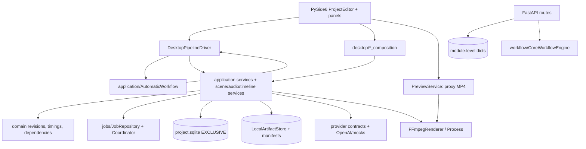

# ARCH-001 — CURRENT_STATE_AUDIT

**Status:** dokumentacja analityczna; stan źródłowy `master`, odczyt 2026-10-31; brak lokalnego checkoutu.

**Skala dowodów:** `C` — sprawdzony plik kodu; `D` — deklaracja w dokumentacji repo (wskazać test/code verification); `V` — wymaga potwierdzenia. Klasyfikacja jest **propozycją migracyjną**, nie dowodem gotowości cloud.

## 1. Aktualna architektura — kod i ścieżki

`AutomaticWorkflow` (313 linii) steruje etapami i błędami/skipami, używając metody `driver`. `DesktopPipelineDriver` (422 linie) implementuje rzeczywiste operacje przez `self.editor`, np. `editor.video_plan.script_service`, `editor.audio.services`, `editor.visuals.services` i `editor.timeline.services`. W `ensure_plan_script` wywołuje `panel._render()`, `panel._script_progress()` i `editor._refresh()`, a przy timeline `editor.timeline.refresh()`, `editor._bind_regeneration()`. To **konkretna granica do wydzielenia**. [Kod workflow](https://github.com/piotrbarabasz/ai-content-generation/blob/master/backend/app/application/automatic_workflow.py), [driver](https://github.com/piotrbarabasz/ai-content-generation/blob/master/backend/app/desktop/pipeline_driver.py).

Uwaga: istnieje też osobny `CoreWorkflowEngine` w `workflow/engine.py` (planowanie modułów, walidacja zależności, retry i approval). Nie deklarować go nowym silnikiem dla desktopowego procesu, póki spike nie porówna semantyki obu ścieżek. Jest realnie używany w [offline long-form integration](https://github.com/piotrbarabasz/ai-content-generation/blob/master/backend/tests/integration/test_long_form_workflow.py), ale API nie wykonuje tego workflow. [API workflow_runs](https://github.com/piotrbarabasz/ai-content-generation/blob/master/backend/app/api/routes/workflow_runs.py).

## 2. Szczegółowy inwentarz i decyzja o warstwach

W kolumnie „Zależności” wymieniono istotne zaobserwowane importy lub zależności logiczne, nie pełne drzewo transytywne. Trudność: S/M/L/XL. Ryzyko: niskie/średnie/wysokie. Przykłady testów potwierdzono w kodzie lub podlinkowanych dokumentach; brak testu oznacza **niezweryfikowane**, nie „brak w repo”.

| Plik / subsystem | Rola + zależności | Klasa | Działanie / argument | Trudność; ryzyko; dowody/testy; konsumenci |
| --- | --- | --- | --- | --- |
| `domain/*` | Rewizje, plany, dependency/fingerprint, timing; standardowa biblioteka, modele | **SHARED_CORE** | Zachować tożsamość oraz rozdział `NarrativeSegment`/`RenderScene`/TTS chunks | M; wysokie przy zmianie kontraktów; `unit/test_editorial_revisions.py`, `unit/test_timeline_editing.py`; application/storage |
| `application/automatic_workflow.py` | Etapy, resume, blocked/cancel; `driver`, `VideoFormat`, `MotionConfig` | **SHARED_CORE** | Podmienić desktop driver na headless przez port; nie przepisywać algorytmu | M; średnie; `AutomaticWorkflow` — nowe testy kontraktu; desktop driver |
| `desktop/pipeline_driver.py` | Adapter orkiestracji do paneli, usług i repozytoriów; `self.editor`, `asyncio` | **SIMPLIFY / UI_REPLACE** | Rozdzielić wywołania usług od metod Qt i refresh; pozostawić stary adapter do czasu parytetu | L; wysokie; brak potwierdzonego dedykowanego testu; `desktop/editor.py` |
| `desktop/editor.py` | `QMainWindow`, stan sesji, `GenerationThread`, `RenderCheckThread`, kompozycja paneli | **UI_REPLACE** | Wyodrębnić inicjalizację usług; niewidoczny w MVP; nie usuwać od razu | L; wysokie; `integration/test_project_editor.py`; desktop runtime |
| `desktop/video_plan_panel.py` | Planowanie + wiązanie `PlanScriptGenerationService`, continuity, duration repair; QThread | **SIMPLIFY** | Zachować usługę planowania, przenieść composition do niezależnego factory | L; wysokie; testy planu i repair do wylistowania; driver/editor |
| `desktop/audio_panel.py`, `narration_panel.py` | UI, wybór/odsłuch/generacja, approval, tryby | **UI_REPLACE / SIMPLIFY** | Zastąpić presetem głosu i zasadami limitów; zachować regenerację i proof audio | M; wysokie dla kosztów; `D078`, `D079`; driver/editor |
| `desktop/cloud_audio.py` | `CloudAudioServices` — **nazwa myląca:** lokalny owner-thread adapter OpenAI Speech + SQLite + pliki | **SIMPLIFY** | Rozbić realne usługi na headless audio runner bez owner-thread Qt; zachować preflight i raw-response recovery | L; wysokie; `D078`, `D079`, `test_duration_repair.py`; desktop product composition |
| `desktop/scene_panel.py`, `scene_planning_panel.py`, `storyboard_panel.py`, `scene_services.py` | Plan scen, kontekst, obrazy, wybór, prompt; Qt + service/repository | **UI_REPLACE / SHARED_CORE** | UI zastąpić podglądem, sceny i ich publikację zachować w services | L; wysokie; coverage to confirm; driver/editor |
| `desktop/scene_composition.py` | Składanie `ImageGenerationService`, `VisualPromptService`, `JobCoordinator`, storage | **SIMPLIFY** | Przenieść fabrykę usług do warstwy niewymagającej Qt/Windows | M; średnie; testy integracji scen do weryfikacji; desktop/main |
| `desktop/timeline_panel.py`, `timeline_composition.py` | Edytor + `TimelineEditingService`/`TimelineCompiler`/ProjectTimelineMedia | **UI_REPLACE / SHARED_CORE** | Zastąpić edytor automatycznym timeline i read-only podglądem; zachować compiler/diagnostics | M; wysokie; `unit/test_timeline_editing.py`, `integration/test_timeline_editing.py`; driver/preview |
| `application/preview.py`, `desktop/preview_composition.py` | Cache proxy i prawdziwe MP4 przez FFmpeg; opcjonalne ffmpeg/ffprobe | **SHARED_CORE** | Użyć w CLOUD-BASED preview po usunięciu desktopowego composition | M; średnie; testy preview/FFmpeg do pełnej inwentaryzacji; panel i render |
| `providers/ffmpeg_render.py`, `runtime/media_process.py` | Koder MP4, filtr video+audio, sprawdzanie wyniku, proces | **SHARED_CORE** | CPU render 640×360/25 FPS w Linux image; sprawdzić zależności filtrów/środowiska | M; wysokie; `integration/test_video_render.py`; preview, final render |
| `application/video_render.py`, `storage/video_render.py` | Frozen render, weryfikacja source, result index | **SHARED_CORE / LOCAL_ONLY final** | Zachować kontrakty i rozdzielić preview vs final; w GCP nie wymuszać motion master | L; wysokie; `integration/test_video_render.py`, D080; regeneration/export |
| `application/image_presets.py` | Orientacja/rozdzielczości `draft`, `fhd`, `qhd`, `uhd4k`; brak SDK | **SHARED_CORE** | Preset cloud tylko target encoding, nie natywny size API | S; średnie; testy image presets do weryfikacji; scene/driver |
| `providers/openai_image.py` + factory | SDK Images, rozmiary/format/transport/throttling | **SHARED_CORE** | W kontenerze bez GPU; walidować rozmiary API; presety przez provider contracts | M; średnie/koszt; kod `validate_gpt_image_2_dimensions`; scene composer |
| `providers/openai_tts.py`, `storage/narration.py`, `runtime/section_synthesis.py` | Synteza WAV, ceny/rezerwacje, cache/chunki i walidacja | **SHARED_CORE** | Zachować retry-limit i zapis raw bytes; poprawić headless composition | L; wysokie; D078/D079; audio services |
| `application/planned_script_generation.py`, `video_planning.py`, `narrative_continuity.py` | Plan/skrypt grupowy, ciągłość, selektywna naprawa | **SHARED_CORE** | Wykorzystać w plan-driven headless flow; bez panelu | L; średnie; D075; video plan |
| `application/shorts.py`, `storage/shorts.py`, `domain/shorts.py` | Analiza/wybór klipów na zweryfikowanym finalnym źródle, lineage i approval | **SIMPLIFY (later)** | Zachować metadane/wybór, wydzielić „selection-only” od final media; nie zmieniać w MVP | L; wysokie; `unit/test_shorts.py`, `integration/test_shorts_media.py`; panel/director |
| `desktop/shorts_panel.py`, `director_panel.py` | UI Shorts i opcjonalny Director | **UI_REPLACE / DEPRECATE_CANDIDATE (UI)** | W MVP prosty status 3 Shorts, approve i pobranie; Director poza MVP | M; średnie; `integration/test_shorts_panel.py`; editor |
| `application/production_quality.py`, `quality_validators.py`, `storage/production_quality.py` | QA media i metadanych, zapisywanie raportów | **SHARED_CORE / SIMPLIFY UI** | Sprawdzać osobne reguły proxy vs final; niczego nie deklarować approved automatycznie | M; średnie; `unit/test_production_quality.py`; Quality panel/publish |
| `desktop/quality_panel.py` | Skan Quick/Deep, decyzja i historia | **UI_REPLACE** | Karta QA/status + celowana akcja review | S; średnie; `D073_PRODUCTION_QA.md`; editor |
| `desktop/export_panel.py`, `branding_panel.py`, `delivery_panel.py` | UI + dostęp do finishing i channel library + eksport | **SIMPLIFY / UI_REPLACE** | Dwa presety: channel, export; cała złożona edycja poza MVP | M; średnie; D076; editor |
| `storage/channel_library.py`, `storage/branding.py`, `application/video_finishing.py` | Wersjonowane profile i assety kanałów, finishing, weryfikacja | **SHARED_CORE / LOCAL_ONLY finishing** | Wydzielić serializowalne channel revision snapshot; dla cloud package zachować referencje/bytes | L; wysokie; D076; Export + final worker |
| `storage/project_repository.py`, `application/projects.py` | Jedna sesja SQLite EXCLUSIVE; immutable revision selection | **LEGACY_KEEP / SHARED_CORE (ports)** | Nie montować współdzielonego SQLite w wielu Cloud Run; udokumentować format migracji/checkpoint | L; bardzo wysokie; `unit/test_project_repository.py`; większość desktop services |
| `jobs/repository.py`, `jobs/coordinator.py`, `storage/result_publication.py` | Lokalny job claim/attempts i atomic publication | **SHARED_CORE contracts / LEGACY_KEEP implementation** | W chmurze Firestore state machine i izolowany runner; nie skopiować koordynatora 1:1 do multi-instance | L; bardzo wysokie; `integration/test_regeneration.py`; audio/render/scene |
| `storage/local_store.py`, `storage/manifest.py`, `storage/paths.py` | Pliki, immutable sidecar, checksums, containment i crash recovery | **SHARED_CORE contracts / CLOUD adapter** | Zachować manifest semantyczny; `GCSArtifactStore` i portable package; brak absolutnych ścieżek | L; wysokie; testy storage to enumerate; wszystkie publikatory |
| `api/main.py`, `api/routes/{projects,workflow_runs,artifacts,approvals}.py` | FastAPI + pamięciowe dicts i statusy; brak execution | **SIMPLIFY / CLOUD_ONLY adapter** | Nowe wersjonowane endpoints na trwałych jobach, nie uznawać starych route za gotowe | M; wysokie; testy API do enumerate; przyszły frontend |
| `workflow/*`, `modules/*`, `providers/registry.py` | Poprzednia modułowa ścieżka: presets, registry, mocks, approvals | **LEGACY_KEEP / INVESTIGATE** | Nie duplikować silnika; zdecydować na spike'ie, jakie moduły współdzielić | L; średnie; `integration/test_long_form_workflow.py`; API/mock |
| `runtime/upscale_runtime.py`, `providers/local_upscale.py` | Opcjonalny Real-ESRGAN CUDA, WindowsJob i resource ownership | **LOCAL_ONLY** | Przenieść do późniejszego workera; nie instalować w cloud image | M; wysokie sprzętowo; D028 testy to enumerate; desktop visuals |
| `runtime/{native_piper,chatterbox_*,profiles,provisioning}.py` i extras pip | Modele TTS, dystrybucja runtime Windows/GPU | **DEPRECATE_CANDIDATE / LEGACY_KEEP** | Tylko po audycie wszystkich lokalnych/retained projektów i sprawdzeniu legalności modeli | M; średnie; D008/D029; audio composition |
| `desktop/__main__.py`, `desktop/deployment.py`, `pyproject.toml` desktop extras | GUI entrypoint, Qt/installer i lokalne aplikacyjne ścieżki | **LEGACY_KEEP / UI_REPLACE** | Zachować aż do akceptacji nowego workflow i archiwum projektów; cloud extras osobno | M; średnie; D041; Windows installer |
| `tooling/*`, `experiments/tts_local/*` | Ręczne/eksperymentalne walidacje | **INVESTIGATE / DEPRECATE_CANDIDATE** | Sprawdzić importy, CI, dokumentację, użycie przed usunięciem | S; niskie; brak pełnego inwentarza |

## 3. Krytyczne ścieżki i konkretne blokery

### 3.1 Headless vs Qt

- `AutomaticWorkflow.run` sprawdza niezapisane drafty, obecność video plan, walidację narracji, wykonuje grupowy skrypt, preflight/budżet, naprawę długości, sceny, obrazy i timeline. Wykonuje **callbacki drivera**, więc mechaniczny refactor nie jest konieczny. `DriverProtocol` może określić wymagane metody i opcjonalne hooki. [Źródło](https://github.com/piotrbarabasz/ai-content-generation/blob/master/backend/app/application/automatic_workflow.py).
- `DesktopPipelineDriver` używa panelowych pól jako locatorów usług; miesza `await asyncio.to_thread(provider...)` z modyfikacjami lokalnych repozytoriów na owner thread. Oddzielenie od Qt wymaga **kompozycji usług i jawnego ownera sesji**, a nie jedynie mockowania widgetów. [Źródło](https://github.com/piotrbarabasz/ai-content-generation/blob/master/backend/app/desktop/pipeline_driver.py).
- `video_plan_panel.py` i `cloud_audio.py` także składają logikę w GUI (`PlanScriptGenerationService`, `CloudAudioServices`); trzeba przenieść miejsce inicjalizacji, nie przenieść klas Qt do backendu. Headless runner jest możliwy, lecz **jeszcze nie istnieje**.

### 3.2 API nie uruchamia produkcji

`api/routes/projects.py` deklaruje `PROJECTS`, `WORKFLOW_CONFIGS`, `WORKFLOW_RUNS`, `ARTIFACTS_BY_RUN`; `/workflow-runs` tylko ustawia `status="running"`, `/resume` ponownie ustawia stan, a `/export-bundle` tworzy jedynie opis `manifest.json`, bez zapisania pakietu. `/artifacts` listuje metadane i nie udostępnia ogólnego byte-download. Przeniesienie wprost do Cloud Run spowodowałoby „fałszywie działające” joby. [Kod](https://github.com/piotrbarabasz/ai-content-generation/blob/master/backend/app/api/routes/workflow_runs.py).

### 3.3 Projekt, lock i zachowanie historii

`storage/project_repository.py` tworzy `project.sqlite` format v2 i używa `PRAGMA locking_mode = EXCLUSIVE`, `BEGIN EXCLUSIVE`, lokalnego workspace. `jobs/repository.py` ma oddzielną logikę attempts/claim, ale też jest project-session-owned SQLite. `storage/result_publication.py` wiąże publikację z expected input fingerprint i stanem sesji. W chmurze przeniesienie pliku na GCS **nie zamienia go w bazę transakcyjną**. Możliwy adapter przejściowy: per-job isolated workspace + spójny backup/checkpoint na GCS na barierach etapów; główne metadane/leases osobno w Firestore. Backup musi powstać ze spójnego snapshotu (SQLite backup API lub zamkniętej sesji), nie z kopii aktywnego pliku.

### 3.4 Podgląd a obraz API

`providers/ffmpeg_render.py` w trybie `proxy=True` wymusza `TimelineRevision`, timebase `(1,25)`, rozdzielczość wyjścia 640×360 / 360×640, `libx264 -preset ultrafast -crf 28 -r 25`, AAC 48 kHz, ffprobe/validację. [Renderer](https://github.com/piotrbarabasz/ai-content-generation/blob/master/backend/app/providers/ffmpeg_render.py). `desktop/preview_composition.py` już składa `PreviewService` i FFmpeg z flagą proxy. To jest **istniejące wsparcie low-res MP4**, nie dowód działania w Linux Cloud Run. `providers/openai_image.py` waliduje rozmiary generowanego obrazu m.in. minimalną liczbą pikseli dla GPT Image 2; nie używać kodowania MP4 jako size requestu Images. W pakiecie zostają oryginalne PNG/JPEG, proxy to pochodna.

### 3.5 Shorts i final media

`application/shorts.py::source()` wymaga completed Standard, źródła przez publishing, mapowania i zweryfikowanej tożsamości. `analyze()` zapisuje candidates z identyfikatorami source, checksums, timeline, zweryfikowanymi granicami. `D071_SHORTS.md` wprost dokumentuje powiązanie z wersjonowanym finalnym materiałem oraz timestampami. **Pierwsza wersja chmury nie powinna renderować Shorts przez istniejący kod na proxy.** Etap późniejszy: wybór wycinków na timingach source, przetwarzanie mediów po finalizacji GPU, odrębne `source_kind=proxy|final` i jasna ponowna walidacja.

### 3.6 Narracja, koszt i ponowna próba

`desktop/cloud_audio.py` to adapter OpenAI Speech utrzymujący dane i działanie na owner thread, nie adapter GCP. `D078_OPENAI_NARRATION.md` pokazuje wersjonowane ustawienia, agregowane akceptacje wydatków, rezerwacje, odzyskiwanie raw response/chunków oraz wyłączony SDK retry. `D079` dodaje skan odzyskiwania. Dla unattended cloud potrzebne **preapproved max spend / run**, max retries per immutable input, blokowanie niepewnego stanu płatnej operacji, zachowanie historycznych prób i aktualizacja cennika. Bez tego nie uruchamiać płatnej produkcji.

### 3.7 Motion masters / final export / QA

`providers/local_upscale.py` korzysta z `runtime/upscale_runtime`, GPU resources i WindowsJob. To warstwa `LOCAL_ONLY`. `application/image_presets.py` rozróżnia `generation_dimensions`, `final_dimensions` i `motion_master_dimensions`; nie wolno zastąpić oryginałów samym małym MP4. `D080_FINAL_RENDER_READINESS.md` opisuje naprawiony niezależny final-render-only path oraz odkryty wcześniej problem z `CloudAudioServices` — zachować testy. `D073_PRODUCTION_QA.md` odróżnia szybki skan od deep QA i nie zastępuje zatwierdzenia redakcyjnego.

## 4. Test coverage — potwierdzone dowody, nie uruchomienie

| Test / dokument | Co weryfikuje | Status audytu |
| --- | --- | --- |
| `backend/tests/unit/test_project_repository.py` | Łączenie i rollback SQLite, revision ownership | plik odczytany; **nie uruchomiono** |
| `backend/tests/unit/test_timeline_editing.py` | Update z optimistic concurrency / pinned sources | plik odczytany; **nie uruchomiono** |
| `backend/tests/integration/test_long_form_workflow.py` | Deterministic `CoreWorkflowEngine` i pliki workflow | plik odczytany; **nie uruchomiono** |
| `backend/tests/integration/test_regeneration.py` | Job Coordinator / publication / immutable | plik odczytany; **nie uruchomiono** |
| `backend/tests/unit/test_production_quality.py` | QA contracts i klasyfikacje | plik odczytany; **nie uruchomiono** |
| `backend/tests/unit/test_shorts.py`, `backend/tests/integration/test_shorts_media.py`, `test_shorts_panel.py` | Shorts logic/media/UI | ścieżki z `D071_SHORTS.md`; **nie uruchomiono** |
| `backend/tests/integration/test_video_render.py` | Właściwy FFmpeg media path | pośrednie importy w `test_regeneration.py`; **nie uruchomiono** |
| `docs/desktop/D080_FINAL_RENDER_READINESS.md` | D080 wskazuje lokalne regresje i FFmpeg smoke | dokument odczytany; historyczny wynik **nie jest wynikiem ARCH-001** |

Nie da się odpowiedzialnie zadeklarować procentowego coverage lub wszystkich istniejących testów bez inwentaryzacji całego drzewa. `CORE-001A` ma dołożyć jawny audit import graph i `pytest --collect-only`.

## 5. Referencja: Tripse — kopiować wzorzec, nie topologię

Zweryfikowano `.github/workflows/ci.yml`, `delivery.yml`, `Dockerfile`, `scripts/gcp/deployment.py`, `docs/GITHUB_CICD.md`, `docs/DEPLOY_GCP.md` w [Tripse](https://github.com/piotrbarabasz/tripse-ai-demo). Przenaszalne: **WIF bez JSON keys**, minimalne permissions, pinowanie obrazu/digestu, oddzielny test offline, immutable deployment proof, smoke i rollback, audyt IAM bez przypadkowych zapisów. Nie przenosić bez potrzeby: DEV/PROD promotion, dwóch projektów/środowisk, rozbudowanego IAP i Cloud Tasks routing, obszernych procedur bootstrapu. AI Content Studio na start: jedno środowisko i bardziej kompaktowy workflow. Konfigurację Terraform z Tripse potraktować jako referencję do odrębnej weryfikacji ścieżek — nie zweryfikowano pełnego modułu Terraform.

## 6. Najważniejsze ryzyka i otwarte dowody

1. **Krytyczne:** niedokończone rozdzielenie Qt od headless; `CloudAudioServices` i `VideoPlanPanel` zawierają konstrukcję realnych usług. Potrzebny kontrakt/port.
2. **Krytyczne:** spójność SQLite / pliki / Firestore / GCS i odzyskanie po przerwanym płatnym żądaniu; nie deklarować exactly-once płatnych operacji.
3. **Wysokie:** kolejność i własność final/proxy/Shorts, 25fps timebase, naprawa długości narracji.
4. **Wysokie:** format pakietu lokalnego workera i ścisłe powiązanie snapshotów audio/obraz/timeline.
5. **Średnie:** zależności ffmpeg/fonty/ass na Cloud Run Linux; koszt CPU i storage.
6. **Średnie:** brak publicznej autoryzacji dla panelu; IAP/Cloud Run IAM dostosować do pojedynczego użytkownika, a nie bezmyślnie kopiować Tripse.
7. **Niezweryfikowane:** wszystkie panele i pliki `modules/*`, rzeczywiste zależności z `backend/tests/`, szczegółowa topologia infra Tripse. Uzupełnić w `CORE-001A` przed wygaszaniem plików.

## 7. Dowody źródłowe — skróty

- [AGENTS.md](https://github.com/piotrbarabasz/ai-content-generation/blob/master/AGENTS.md) — dotychczasowa polityka zachowania kontraktów.
- [Overview](https://github.com/piotrbarabasz/ai-content-generation/blob/master/docs/architecture/overview.md), [API and storage](https://github.com/piotrbarabasz/ai-content-generation/blob/master/docs/architecture/api-and-storage.md).
- [Automatic workflow](https://github.com/piotrbarabasz/ai-content-generation/blob/master/backend/app/application/automatic_workflow.py), [desktop driver](https://github.com/piotrbarabasz/ai-content-generation/blob/master/backend/app/desktop/pipeline_driver.py), [editor](https://github.com/piotrbarabasz/ai-content-generation/blob/master/backend/app/desktop/editor.py).
- [Project repository](https://github.com/piotrbarabasz/ai-content-generation/blob/master/backend/app/storage/project_repository.py), [jobs repository](https://github.com/piotrbarabasz/ai-content-generation/blob/master/backend/app/jobs/repository.py), [publication](https://github.com/piotrbarabasz/ai-content-generation/blob/master/backend/app/storage/result_publication.py).
- [Preview](https://github.com/piotrbarabasz/ai-content-generation/blob/master/backend/app/application/preview.py), [renderer](https://github.com/piotrbarabasz/ai-content-generation/blob/master/backend/app/providers/ffmpeg_render.py), [Shorts](https://github.com/piotrbarabasz/ai-content-generation/blob/master/backend/app/application/shorts.py), [upscale](https://github.com/piotrbarabasz/ai-content-generation/blob/master/backend/app/providers/local_upscale.py).
- [D071 Shorts](https://github.com/piotrbarabasz/ai-content-generation/blob/master/docs/desktop/D071_SHORTS.md), [D078 OpenAI](https://github.com/piotrbarabasz/ai-content-generation/blob/master/docs/desktop/D078_OPENAI_NARRATION.md), [D080 Final Render](https://github.com/piotrbarabasz/ai-content-generation/blob/master/docs/desktop/D080_FINAL_RENDER_READINESS.md).
