# ARCH-001 — MIGRATION_BACKLOG

**Status:** plan nowej migracji `PROPOSED`, **nie zatwierdzony**. Stan bazowy: inspekcja `master` z 2026-10-31; żaden z poniższych tasków implementacyjnych nie został wykonany podczas ARCH-001. Po zatwierdzeniu nowego ADR plik będzie **autorytatywny tylko dla nowej migracji cloud/hybrid**. Dotychczasowy `docs/desktop/IMPLEMENTATION_PLAN.md` pozostaje autorytatywny dla historii i tasków D###.

## 1. Zależności i first vertical slice

```mermaid
flowchart LR
 A[ADR-001] --> B[CORE-001A: discovery]
 B --> C[CORE-001B: headless mock]
 C --> D[CORE-002A: real proxy MP4]
 D --> E[STORAGE-001A: package contract]
 E --> F[CORE-002B: complete local package]
 F --> G[STORAGE-001B: basic GCS persistence]
 G --> R[STORAGE-001C: persistent metadata]
 R --> H[API-001A: durable API]
 H --> S[API-001B: dispatch and reconciliation]
 F --> I[DEPLOY-001A: Docker/IAM/Terraform]
 S --> J
 I --> J[DEPLOY-001B: cloud vertical slice]
 J --> K[UI-001: web control center - independent]
 J --> L[CLOUD-PAID-001: approved CLI/API smoke]
 R --> T[STORAGE-001D: lease/checkpoint/recovery hardening]
 S --> T
 T --> M
 L --> V[Full ~10-minute acceptance - separate opt-in run]
 V --> M
 L --> M[CLOUD-001: weekly scheduler later]
 J --> N[LOCAL-001A: verify package]
 N --> U[LOCAL-001B: final GPU later]
 U --> W[SHORTS-001A: source mapping]
 W --> O[SHORTS-001B: 3 vertical Shorts]
 O --> P[PUBLISH-001]
 P --> Q[CLEANUP-001]
```



**First working vertical slice (offline, bez chmury):** `CORE-001B → CORE-002A → STORAGE-001A → CORE-002B`: headless mock od planu/skryptu do obrazu/narracji/timeline, prawdziwy 640×360 MP4, checksums, portable package i test odtworzenia. Zostaje tylko jeden proces i temp workspace. **First working cloud vertical slice:** `STORAGE-001B/001C + API-001A/001B + DEPLOY-001B`: `POST production` → persistent status → Cloud Run Job → GCS package/MP4 → authenticated GET/preview, bez TTS Images paid i bez panelu UI. `CLOUD-PAID-001` dopiero odblokowuje faktyczne OpenAI requesty w środowisku cloud.

Uwaga o kolejności: `CORE-002A` produkuje testowe źródła/MP4; `CORE-002B` gwarantuje **pełny pakiet**, dlatego sama flaga `CORE-002` bez obu części **nie oznacza akceptacji**. `API-001A` może być budowany lokalnie przed deployem, ale po uzgodnieniu schematu Firestore.

### Implementation sequence — PROPOSED

Local headless production → complete offline package and real proxy → single-environment GCP infrastructure and persistent job execution → manually approved, budget-limited real OpenAI smoke through CLI/API. `UI-001` can follow independently after the cloud mock slice; it is not a dependency of `CLOUD-PAID-001`. Real OpenAI calls remain disabled throughout ARCH-001.

Storage is incremental: portable manifest (`STORAGE-001A`) → basic GCS (`STORAGE-001B`) → persistent metadata (`STORAGE-001C`) → full lease/checkpoint/recovery hardening (`STORAGE-001D`). Controlled runs stop for manual reconciliation after interruption or ambiguous paid outcomes. Full safe recovery is mandatory before unattended `CLOUD-001`; no distributed transaction framework is required upfront.

## 2. Zadania — granice, testy i kryteria

### Governance i Core

| ID / tytuł | Cel i zakres (**in/out**) | Dotknięte moduły; zależności | Deliverables + obowiązkowe testy i acceptance | Risk / complexity |
| --- | --- | --- | --- | --- |
| `ARCH-001` — Audit & Simplification | **In:** code audit, podział cloud/local, decyzje, docs. **Out:** produkcyjny kod, cloud, deletion | `docs/cloud-migration`; bez zależności | Sześć plików MD, powiązane linki, jawne VERIFY, docs whitespace checks. Akceptacja: brak zmian poza docs, plan first slice, decyzje pozostają Proposed | M / M |
| `ADR-001` — Cloud/hybrid governance | **In:** nowy ADR, przypisanie authority backlogów i zakres supersession. **Out:** usuwanie starych decyzji | `docs/decisions`, `AGENTS.md`, `docs/ROADMAP.md` **tylko jeśli owner zatwierdzi**; `ARCH-001` | Proposed ADR, linki, decyzje accepted/rejected po review; test docs links/references; acceptance: `ADR 0003` nienaruszony historycznie, D### nie zmienia statusów | M / S |
| `CORE-001A` — Headless boundary audit | **In:** pełny import graph, ściągnięty source tree, test collection, dokładny opis GUI coupling. **Out:** zmiana zachowania | `automatic_workflow.py`, `desktop/*`, `pyproject.toml`, `backend/tests`; ADR-001 | Map funkcji driver, rzeczywiste consumer/test paths, brak niedopowiedzianego dead code. Testy `pytest --collect-only`, import smoke bez PySide6; acceptance: wykaz metod wymaganych DriverPort i round-trip ownership | M / M |
| `CORE-001B` — Injectable headless runner | **In:** `HeadlessPipelineDriver`/composition, fake LLM/Images/TTS, jeden temp workspace, deterministic Plan → Script → Narration → Scenes → Timeline. **Out:** GCP, real API calls, MP4 | `application/automatic_workflow.py`, `desktop/pipeline_driver.py` (tylko refactor bez zmian GUI), `application/*`, `storage/*`; CORE-001A | CLI/service test, fake provider fixtures, resume/cancel/stale/owner-thread tests. Acceptance: `import app.cloud` bez Qt (lub headless module), żadna metoda widgetu nieobowiązkowa, istniejący desktop nadal działa | H / L |
| `CORE-002A` — Real proxy render | **In:** istniejący `FFmpegRenderer(proxy=True)` Linux-compatible composition, 640×360 25fps MP4 dla landscape. **Out:** final HD, cloud | `application/preview.py`, `providers/ffmpeg_render.py`, `storage/video_render.py`, `runtime/media_process.py`; CORE-001B | Real offline `ffprobe` H.264/AAC/25FPS, audio mapping/frames, cancellation, caching, asset bytes unchanged; acceptance: playable MP4 bez GUI i bez PySide6 | H / M |
| `STORAGE-001A` — Portable manifest contract | **In:** schemat `production-package/v1`, SHA256, relative paths, lineage, sample/frame timing, source identity. **Out:** cloud storage/network | `storage/{manifest,local_store}.py`, `domain/*`, new portable package module; CORE-002A | JSON Schema/model, reference fixture + local verifier. Tests: ZIP traversal, missing/corrupt file, immutable provenance, canonical ordering, Windows↔POSIX path mapping. Acceptance: manifest jest wystarczający do przyszłego final render, bez absolutnych ścieżek | H / M |
| `CORE-002B` — Complete offline draft package | **In:** end-to-end headless mock, prawdziwe proxy + frozen script/narration/images/timeline i export package. **Out:** GCP deploy, paid calls, Shorts | `application/*`, `storage/*`, `providers/mock_*`, packaging; CORE-002A, STORAGE-001A | Short synthetic production smoke: 30–90 s materiału, deterministic providers, restart/resume, checksums, pack/unpack/read-only verification, no paid API. Acceptance: pierwsza pełna lokalna paczka `COMPLETE_DRAFT` i powtarzalny `proxy.mp4` | H / L |

### Cloud persistence, API i wdrożenie

| ID / tytuł | Cel i zakres (**in/out**) | Dotknięte moduły; zależności | Deliverables + obowiązkowe testy i acceptance | Risk / complexity |
| --- | --- | --- | --- | --- |
| `STORAGE-001B` — Basic GCS persistence | **In:** immutable package/source upload/download, SHA256, object generation preconditions. **Out:** metadata DB, leases, automatic recovery | `storage/*`, `cloud/storage.py`; CORE-002B, DEC-06/07 | Fakes: upload failure, corrupt/missing object, duplicate upload. Acceptance: verified package restored from GCS; partial upload never COMPLETE; manual operator only | M / M |
| `STORAGE-001C` — Persistent production metadata | **In:** Firestore production/status/attempts/approvals, idempotency, verified manifest pointer, single-run ownership. **Out:** full stage recovery, unattended runs | `jobs/*` ports, `cloud/metadata.py`; STORAGE-001B, DEC-05/06 | Fakes/emulator: API restart, CAS conflict, duplicate claim, stale pointer. Acceptance: status/approval history survives restart; no half-published head; interrupted or ambiguous run BLOCKED for operator reconciliation, no automatic replay | H / L |
| `STORAGE-001D` — Recovery hardening | **In:** expiring/fenced leases, consistent SQLite stage checkpoints, reconciliation, restart/resume. **Out:** distributed transaction framework | `storage/*`, `jobs/*`, `cloud/*`; STORAGE-001C, API-001B | Failure injection: crash before/after upload and metadata commit, lease expiry, stale worker, unknown paid outcome. Acceptance: recovered original bytes, fenced publication, no duplicate paid retry; safe recovery mandatory before unattended CLOUD-001 | H / L |
| `API-001A` — Persistent production API | **In:** create/get/list/status/artifacts + idempotency + approval/retry restrictions; **out:** long work inside request | `api/main.py`, new `api/routes/productions.py`, Pydantic DTO, metadata port; STORAGE-001C | API tests for durable restart, 2 creates same key, authn/authz, 409 stale/unknown_paid, no direct runner invocation. Acceptance: API schema corresponds to real persisted production | H / L |
| `API-001B` — Run dispatch & reconciliation | **In:** enqueue execution, delayed dispatch reconciliation, status of Cloud Run Job, retries only when safe. **Out:** weekly schedule | `cloud/job_dispatch.py`, `api/*`; API-001A | Fake Jobs API + network timeout, duplicate requests, orchestration ownership; acceptance: every persistent queued production has one active owner or explicit BLOCKED state requiring operator reconciliation, not a false „running” | H / M |
| `DEPLOY-001A` — Single-env GCP foundation | **In:** minimal Dockerfile (Python+FFmpeg no Qt/CUDA), Artifact Registry, IAM/WIF, Secret Manager, GCS/Firestore, infra plan and CI. **Out:** terraform apply without approval, extra dev/prod | `infra/gcp/*`, `Dockerfile`, `.github/workflows/*`, `scripts/*`, `pyproject.toml` optional cloud extras; CORE-002B, ADR-001 | `terraform fmt/validate/plan` offline where possible, image import/no Qt/CUDA, container FFmpeg smoke, CI PR/no credentials, digest tagging, policy test. Acceptance: reviewed plan with zero unapproved IAM changes | H / L |
| `DEPLOY-001B` — Cloud MVP vertical slice | **In:** operator-approved apply, deploy Service+Job, mock headless execution and package to GCS, smoke & rollback. **Out:** paid OpenAI run, schedule, local finisher | `cloud/runner`, `infra/gcp/*`, CI; DEPLOY-001A, API-001B | Real private authenticated smoke, job trace→Firestore→GCS, checksum verification, interrupted-run blocking/manual reconciliation, rollback; acceptance: po deploy `POST` prowadzi do playable proxy i paczki, history survives restart | H / XL |
| `UI-001` — Lightweight Web Control Center | **In:** React+TS/Vite, channels, create production, polling progress, artifact preview/approve. **Out:** timeline editor, intricate audio/branding settings | `frontend/*`, `api/*`, Cloud Run static hosting; API-001A, DEPLOY-001B | Component tests/e2e viewport/invalid state, 401/403 handling, no API key leak, visual smoke; acceptance: pojedynczy operator może utworzyć i ocenić mock production bez CLI | M / M |
| `CLOUD-PAID-001` — Controlled OpenAI production | **In:** real structured LLM, Speech, Images z limitami i archiwizacją raw responses; pricing refresh, quota. **Out:** scheduler, public API, Shorts | `providers/*`, `storage/narration.py`, `cloud/*`; CORE-002B, DEPLOY-001B, DEC-15 | Transport fakes i fault injection: ambiguous paid outcome, budget exhausted, partial Speech, invalid Image, stale source; manual live 30–90 s production smoke through authenticated CLI/API (no React/UI dependency), explicit per-run budget approval; full ~10-min acceptance separately funded and opt-in; manual live acceptance po osobnej zgodzie. Acceptance: brak nieograniczonych retry i kompletne źródła | H / XL |
| `CLOUD-001` — Weekly scheduling | **In:** Cloud Scheduler once/week, 1 long/3 Shorts target metadata; budgeting/notify. **Out:** auto-publish | `cloud/*`, `infra/gcp/*`; CLOUD-PAID-001, STORAGE-001D, full ~10-min acceptance | Dry-run schedule, dedup week key, no job at insufficient budget, alarms, missed run replay; acceptance: unattended weekly run, fail closed on cost | M / M |

### Local finishing, Shorts, publishing, cleanup

| ID / tytuł | Cel i zakres (**in/out**) | Dotknięte moduły; zależności | Deliverables + obowiązkowe testy i acceptance | Risk / complexity |
| --- | --- | --- | --- | --- |
| `LOCAL-001A` — Package consumer and verification | **In:** local Windows client pobiera paket i weryfikuje identity/checksums. **Out:** upscale i final render | `local_worker/*`, `storage` portable reader; STORAGE-001A, DEPLOY-001B | Path traversal, corrupt bytes, resume upload, locked source identity tests; acceptance: pakiet weryfikuje się offline i nie modyfikuje źródeł | M / M |
| `LOCAL-001B` — GPU source upscale + final | **In:** source PNG/JPEG → Real-ESRGAN motion master → FFmpeg FHD/4K, optional caption burn-in, media QA/upload. **Out:** YouTube | `local_worker/*`, `providers/local_upscale.py`, `runtime/upscale_runtime.py`, final renderer; LOCAL-001A | Windows CUDA hardware smoke; 25fps frames; full decode; final checksum; crash/resume; source-upscale vs MP4-upscale quality A/B; acceptance: reproducible verified final, original input unchanged | H / XL |
| `SHORTS-001A` — Source mapping contract | **In:** oddzielone plans/metadata 3 clips (30–60s), exact sample and frame boundaries, source_kind+identity. **Out:** pełna Short encoding | `domain/shorts.py`, `application/shorts.py`, `storage/shorts.py`; LOCAL-001B | Tests for source final/proxy mismatch, stale revision, offset/caption mapping, no hallucinated timestamps; acceptance: candidates not falsely marked ready | H / L |
| `SHORTS-001B` — Final 9:16 Shorts | **In:** three verified vertical MP4 excerpt outputs, simple review; **out:** AI Director (separate scope) | `local_worker/*`, `application/shorts.py`, `providers/shorts.py`; SHORTS-001A | 3× ffprobe 1080×1920 or agreed profile, SAR=1, rotation/orientation, exact audio, burn-in QA, offset checks, dedup/cancel; acceptance: zero poziomych Shorts | H / L |
| `PUBLISH-001` — YouTube handoff | **In:** approval, OAuth, non-public staged upload, metadata/subtitles, optional schedule. **Out:** unattended public publication by default | `application/publishing*`, `api/*`, `cloud/*`; SHORTS-001B, review approval | Mock OAuth/upload, idempotency, approval provenance, no revoked token leak, sandbox/unlisted live smoke; acceptance: publikacja wyłącznie zatwierdzonego exact artifact SHA | H / L |
| `CLEANUP-001` — Legacy removal | **In:** potwierdzony dead-code graph, archive readers, per-provider deprecation PRs, migration guide. **Out:** niesprawdzone usuwanie historycznych danych | `desktop/*`, `runtime/*`, optional extras, `tooling/*` i docs; PUBLISH-001 + specjalna zgoda | Test otwarcia historycznych workspace i retain artifacts, import graph, regression baseline, rollback; acceptance: spis usuniętych plików i brak utraty ważnych kontraktów | H / L |

`L`/`M` w kolumnie pierwszej oznacza ryzyko? **Nie:** tabela używa `Risk / complexity`, `H` = wysokie ryzyko, `M` = średnie ryzyko. Rozmiar złożoności: `S` mały, `M` średni, `L` duży, `XL` bardzo duży. Aby uniknąć kolizji, wyjaśnienie dla `M / M` to średnie ryzyko i średnia złożoność. Wpis `ARCH-001 M/M` ocenia pracę dokumentacyjną.

## 3. Cross-cutting acceptance gates

**Gate G0 — before implementation:** accepted cloud ADR, existing desktop unaffected, baseline test inventory, no secrets in history.

**Gate G1 — headless:** `AutomaticWorkflow` runs with deterministic providers, no Qt imported; one session owns repo writes, cancellation/recovery proven.

**Gate G2 — offline package:** real ffprobe verified MP4, original PNG/JPEG and audio unchanged, manifest complete SHA256, ZIP unpack valid; corrupt/partial input rejected.

**Gate G3 — cloud mock:** private API and durable state (STORAGE-001B/001C), reconcile orphan queue/job or BLOCK for operator, no half-published package, CI+WIF+rollback. Full automatic stage resume belongs to STORAGE-001D, mandatory before unattended scheduling.

**Gate G4 — paid:** controlled 30–90 s CLI/API smoke without UI dependency; operator explicitly approves cap/prompt/estimated spend; per-chunk attempts bounded, unknown paid operation pauses, no new paid calls from a viewing action.

**Gate G5 — final local:** GPU source upscale, final H.264/AAC QA and source mapping, optional subtitles, upload verification.

**Gate G6 — Shorts/Publish:** three vertical Shorts with exact lineage and separate editorial approvals, YouTube only on explicit confirmation.

### Two production acceptance levels — PROPOSED

- **Short synthetic production smoke:** approximately 30–90 seconds of media, deterministic sources/providers, real FFmpeg proxy, manifest/checksums and pack/unpack. This is the offline regular CI path; duration means media length, not test runtime. Cloud mock reuses the short input. The real-provider variant is manual `CLOUD-PAID-001`, through CLI/API with explicit budget approval, never regular CI.
- **Full production acceptance:** approximately 10 minutes of media, continuity/duration/source completeness and QA. Separate, more expensive, manual/opt-in validation with a separate approved budget for live providers; not required in every regular CI run. Mandatory together with `STORAGE-001D` before unattended `CLOUD-001`.

## 4. Wymagane komendy/walidacje przy implementacji

W lokalnym checkout środowiska Python 3.11+:

```bash
python -m pytest backend/tests/unit/test_project_repository.py
python -m pytest backend/tests/unit/test_timeline_editing.py
python -m pytest backend/tests/integration/test_long_form_workflow.py
python -m pytest backend/tests/integration/test_regeneration.py
python -m pytest backend/tests/unit/test_production_quality.py
python -m pytest backend/tests
python -m compileall -q backend/app backend/tests
git diff --check
```

Dodać **nowe dedykowane testy** `test_headless_*`, `test_portable_package_*`, `test_cloud_state_*`, `test_api_productions_*`, `test_proxy_linux_*`, `test_local_worker_*`. Powyższe są komendami wymaganymi dla przyszłych tasków, nie wynikami wykonanymi w ARCH-001. Rzeczywiste media Linux/Windows sprawdzać osobno ffprobe + full decode. Nie uruchamiać live paid OpenAI podczas domyślnego CI.

## 5. Definition of done dla pierwszego sprintu

Po `CORE-001B` aplikacja headless bez Qt przechodzi ten sam plan skróconej offline produkcji, który działa w desktop: skrypt, WAV, scena, obraz, timing, frozen timeline. Test potwierdza resume i brak zduplikowanych zapisów. Dopiero wtedy `CORE-002A` wytwarza MP4 proxy i `STORAGE-001A` + `CORE-002B` spina archiwum. Nie zaczynać nowego frontend design system ani infrastruktury przed potwierdzonym rzeczywistym end-to-end, bo maskuje to najdroższą niepewność — czy da się uruchomić produkcyjny pipeline bez GUI.
