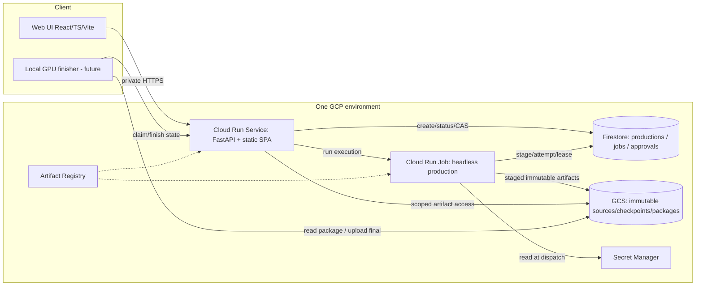
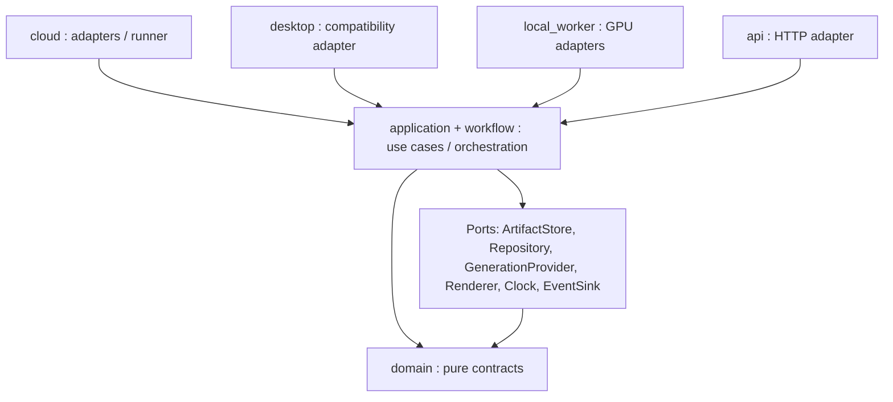
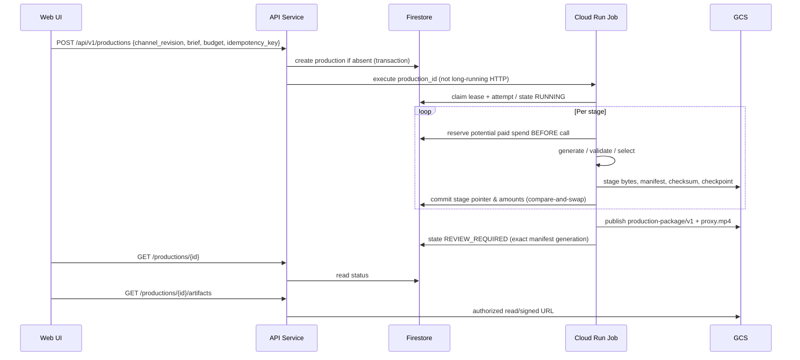

# ARCH-001 — TARGET_ARCHITECTURE

**Status:** `PROPOSED / NOT IMPLEMENTED`. Projekt docelowy wynikający z [audytu](CURRENT_STATE_AUDIT.md), nie opis działającego cloud deploymentu.

## 1. Zasada pięciu warstw i dwa deployables



**A Web UI** = dashboard, channel profiles, production start, progress, preview, review. Nie importuje klas Core; komunikuje się wyłącznie przez HTTP.

**B API** = FastAPI, auth, walidacja, idempotentna komenda `create production`, DTO i artifact URLs; NIE wykonuje TTS/FFmpeg w handlerze.

**C Shared Production Core** = `domain/`, `application/`, `workflow/` jako istniejące kontrakty i spójna orkiestracja; nie importuje FastAPI, PySide6 ani SDK GCP.

**D Cloud Runtime** = `cloud/` zawierające composition, GCS/Firestore adapters, runner CLI, reconciliation, provider secrets, CPU FFmpeg.

**E Local Worker** (future) = `local_worker/` z Real-ESRGAN, FFmpeg final 1080p/4K i upload result. Nie jest wymagany w MVP.

Zalecany **modułowy monolit**, bez osobnego serwisu per agent/provider. Jeden obraz może mieć dwie entrypoints (`uvicorn ...` i `python -m app.cloud.run_production`) z różnymi rolami IAM. Jeżeli rozdzielenie pakietów w obrazie poprawi rozmiar/surface, dopuścić dwa build targets, ale nie wymagać tego w pierwszej iteracji. `PySide6`, CUDA, torch i Windows-only dependencies **nie mogą znajdować się w cloud image**.

## 2. Interfejsy importów i własność danych



**Zakazane kierunki:**

- `domain/` → `api/`, `desktop/`, `cloud/`, `local_worker/`, `storage/*` (concrete), `PySide6`, GCP SDK.
- `application/automatic_workflow.py` → `desktop/*`, `fastapi`, `google.cloud.*`.
- `cloud/` → `desktop/*` ani `PySide6`, `runtime/windows_*`, CUDA/Torch.
- `api/` → `desktop/editor.py` ani adapter GUI; w API wyłącznie wysłanie komendy i odczyt stanu.
- `local_worker/` → `api` implementacja/Cloud SDK jako twardy runtime dependency Core; komunikacja przez port/HTTP client, opcjonalne adaptery.
- `frontend/` → dysk lokalny/GCS client secrets; wszystkie operacje chronione przez API i scope.

`storage/*` nadal może zawierać lokalne implementacje, ale API nie powinno zakładać, że `ProjectRepository` jest dostępnym multi-instance cloud store. Podział nie wymaga przeniesienia setek istniejących plików — pierwsze zmiany to nowe adapters/factories i stabilizacja portów.

## 3. Produkcja: state machine, odporność i koszt



**Stany jobu:** `CREATED → QUEUED → RUNNING → {BLOCKED_BUDGET, BLOCKED_INPUT, FAILED_RECOVERABLE, FAILED_FINAL, REVIEW_REQUIRED}`; osobno `APPROVED`, `REJECTED`, `FINISHED_LOCAL` i `PUBLISHED` dla produktów. Każda transakcja/attempt ma `production_id`, `attempt_id`, `lease_token`, `stage`, `stage_fingerprint`, `started_at`, `expires_at`, `provider_request_id` (tylko jeśli bezpiecznie dostępne), `reserved_cost`, `reported_cost`, `outcome`, `error_code` (bez secret/provider body), `checkpoint_generation`.

**Ważne:** Cloud Run Jobs + Firestore nie dają exactly-once płatnych API. `reconcile` może odzyskać zapisany raw response, lecz gdy proces padł po opłaceniu a przed zapisem, status jest `UNKNOWN_PAID_OUTCOME`: **bez automatycznego re-requestu**. Limit budget dotyczy `spent + reserved` i możliwych nierozliczonych prób. Preflight wykorzystuje istniejące D078/D079, ale cloud cap i pricing refresh to dodatkowy wymóg. Dostęp bez UI confirmation tylko z zaakceptowanym limitem i konkretną rewizją job config.

Na MVP przy jednym filmie/tydzień nie potrzeba Cloud Tasks i Cloud Scheduler. Po utworzeniu job rekordu API wywołuje Cloud Run Jobs execution; osobny reconciler naprawia sytuację „Firestore queued, execution not started”. Dla błędów dostawy komunikatu `POST` idempotency key umożliwia wykrycie duplikatu.

## 4. Spójność projektu: SQLite → cloud

`ProjectRepository` używa SQLite `EXCLUSIVE` i związanego z katalogiem `project.sqlite` session; GCS nie jest współdzielonym filesystemem z lockiem. Minimalna bezpieczna strategia przejściowa:

1. `production_id` tworzy **jeden prywatny workspace** w `/tmp/work/<id>`, tylko na czas jednego wykonawcy.
2. Headless composer otwiera istniejące local SQLite/project adapters wyłącznie w procesie runnera, zachowując jednego właściciela thread.
3. Po każdej **barierze etapu** trwałe oryginalne artefakty zapisuje do GCS (SHA256, path safety, generation precondition). Spójny stan SQLite przygotowuje przez `sqlite3.Connection.backup` / zamknięcie transakcji i zapis checkpointu **bez kopiowania aktywnego, niespójnego pliku**. Każdy checkpoint ma ID, checksum, parent ID, schema version i odpowiadający manifest pointer.
4. Firestore atomowo wskazuje ostatni kompletny `checkpoint_generation`/`manifest_generation` dopiero po uploadach i walidacji.
5. Po restarcie runner pobiera pakiet i **odtwarza lokalny project workspace**. Jeśli format/schemat niezgodny, `BLOCKED_INPUT` i manual restore, bez ślepej migracji.
6. Dotychczasowe katalogi użytkownika pozostają nietknięte; migracja historycznych projektów wymaga explicit import/read-only conversion.

To **proposal do prototypu**. `STORAGE-001A` musi rozstrzygnąć crash windows, granice transakcji `ResultArtifactIndex` i koszty przenoszenia długich mediów. Alternatywa długoterminowa: dedykowany Repository Port z implementacją Firestore/relational, bez użycia SQLite w cloud; bardziej kosztowna migracja, niewymagana dla v1.

## 5. `production-package/v1` — portable source contract

Pakiet logiczny nie może być wyłącznie `preview.mp4` i nie powinien zależeć od lokalnej litery dysku. Przykład **proponowanego** drzewa:

```text
productions/<production-id>/
  manifest.json                       # immutable version 1, canonical JSON
  checkpoints/<checkpoint-id>/...
  sources/
    script/<revision-id>.json
    audio/<artifact-id>.wav
    images/<artifact-id>.png
    plans/<plan-id>.json
    timeline/<revision-id>.json
    channel/<profile-revision>.json
  derivations/
    proxy.mp4
    qa-preview.json
  review/
    decisions.json
  package/production-package-v1.zip  # optional convenience, same content
  local/
    final/<artifact-id>.mp4           # later LOCAL-001, separate lineage
```

Minimalny `manifest.json` w schemacie v1:

```json
{
  "schema": "production-package/v1",
  "production_id": "prod_example",
  "created_at": "ISO-8601-UTC",
  "channel_revision_id": "channel_rev_example",
  "script_revision_id": "script_rev_example",
  "timeline_revision_id": "timeline_rev_example",
  "timebase": {"num": 1, "den": 25},
  "audio_sample_rate": 48000,
  "render_profile": {"kind": "proxy", "width": 640, "height": 360, "fps": 25},
  "source_resolution_policy": "preserve-original-bytes",
  "assets": [
    {"kind": "source-image", "artifact_id": "img_example", "relative_path": "sources/images/img_example.png", "size": 1234, "sha256": "64-hex-sha256-here", "media_type": "image/png"}
  ],
  "dependencies": {"fingerprint_format": "canonical-v1", "expected_source_ids": []},
  "review_status": "UNREVIEWED",
  "generation_identity": {},
  "source_timings": [],
  "renderer_identity": {},
  "package_checksums": {},
  "status": "COMPLETE_DRAFT"
}
```

Ten JSON to **szkic kontraktu**, nie gotowy payload ani formalny schema. Przed implementacją ustalić: kanoniczny serializator, `uri`/GCS generation, znormalizowane ścieżki POSIX, SHA-256 rzeczywistych bytes, rozdział `NarrativeSegment`/`RenderScene`/technical chunks, timebase, exact frame/sample spans, fit/fill, motion seed/policy, crop coordinates, model identity i provider settings non-secret. Nie pakować API keys, osobistej referencyjnej mowy, absolutnych ścieżek ani uprawnień użytkowników. Każdy required asset musi przejść integrity scan, każdy optional jawnie `missing`/`not produced`.

**Source-image upscale vs final MP4 upscale:** preferowane źródłowe PNG/JPEG → GPU Real-ESRGAN → motion master w docelowym profilu → FFmpeg final encode z oryginalną narracją i exact timing. Upscaling gotowego MP4 gubi oryginalny detal, pogłębia artefakty kompresji i nie pozwala wiernie odtworzyć motion/text. To pierwsza hipoteza do weryfikacji jakościowej, nie dogmat — w `LOCAL-001B` porównać obraz, koszt i stabilność.

## 6. Preview i Shorts

**Proxy:** już istniejące `FFmpegRenderer(proxy=True)` wyjście 640×360/360×640 25 FPS; `PreviewService` reuse/cache. Warunek: `TimelineRevision.timebase == OutputTimebase(1,25)`, oryginalne obrazki i WAV wejściowe w staging bez zmian. Cloud smoke ma potwierdzić działający H.264/AAC MP4 i frame counts w realnym Linux FFmpeg (libx264, AAC, opcjonalne subtitles/filter availability), nie tylko syntetyczne mocked artifacts.

**Shorts:** `ShortsService::source` wymaga completed Standard, ownership przez `publishing.original`, verified timeline/media. W cloud v1 **tylko opcjonalne pomysły/metadata**, nie zakładamy, że stary renderer akceptuje proxy jako final source. Po `LOCAL-001` etap `SHORTS-001` odtwarza source identity, mapping i remap do zweryfikowanego final MP4; test 9:16 zawsze pionowo (ffprobe, SAR/DAR/rotation/frames). Plan trzech 30–60 s Shorts jako przyszły target, nie warunek pierwszej produkcji.

## 7. API (projekt endpointów; nie obietnica kompatybilności)

| Metoda | URL | Cel / gwarancja |
| --- | --- | --- |
| `GET` | `/api/v1/channels` | profile + revisions, bez secrets |
| `POST` | `/api/v1/channels` | nowa immutable revision/preset |
| `POST` | `/api/v1/productions` | `idempotency_key`, budget, immutable config; `202` i job id, brak długiej pracy w handlerze |
| `GET` | `/api/v1/productions` | historia, sort, filtry stanów |
| `GET` | `/api/v1/productions/{id}` | trwały stage/progress/status/cost/manifest pointer |
| `GET` | `/api/v1/productions/{id}/artifacts` | filtr metadata + authorized URLs (bounded TTL) |
| `POST` | `/api/v1/productions/{id}/retry` | jawny scoped retry i budget guard; `409` gdy lease/unknown paid |
| `POST` | `/api/v1/productions/{id}/decisions` | approve/reject z expected revision i audytowaną decyzją |
| `GET` | `/api/v1/health` | readiness bez ujawniania secrets, przy prywatnym dostępie |
| `POST` | `/api/v1/productions/{id}/finishing` | **future:** przekazanie do local worker tylko po validated manifest |

SSE lub `GET polling 3–10 s`? Rekomendacja na start **polling**, wystarczające przy 1 produkcji tygodniowo i proste w Cloud Run. No web sockets i mutable client-side source of truth. `GET` job state/attempts jest jedynym statusowym źródłem prawdy.

## 8. GCP deployment, bezpieczeństwo i koszt operacyjny

**Jedno środowisko** (region do potwierdzenia w `DEPLOY-001A`) i początkowo: `Cloud Run Service`, `Cloud Run Jobs`, `Artifact Registry`, `Cloud Storage`, `Firestore`, `Secret Manager`, konta serwisowe z least privilege, logi i podstawowe alerty. Scheduler, Tasks, centralny agent orchestrator, Kubernetes, Cloud SQL i wielośrodowiskowa promocja **nie są potrzebne**.

- Różne service accounts i permissions: API może **tworzyć execution** i czytać metadane, ale nie pozyskuje klucza OpenAI do przeglądarki; runner odczytuje sekret i zapisuje tylko do wybranego prefixu GCS; finisher nie ma prawa zmieniać źródłowych manifestów.
- UI prywatne: Cloud Run IAM/IAP, bez publicznego „run paid generation”; walidacja sesji także dla artefaktów i wewnętrznych operacji. Obsługa IAP musi być zweryfikowana na miejscu, nie opisana jako automatycznie gotowa.
- GCS: uniform bucket-level access, storage versioning / retention polityka po decyzji, restricted CORS, signed download (krótki TTL); nie wrzucać `OPENAI_API_KEY` do manifestu/publish metadata.
- Deployment: GitHub OIDC → WIF, immutable SHA/digest, deterministic build z FFmpeg + locked deps, PR unit/integration offline, deploy na zatwierdzony ref, Cloud Run health/smoke (auth), audyt IAM, rollback do poprzedniego digestu, bez `SetIamPolicy` w zwykłym deploy workflow. Korzystać z przykładu [Tripse delivery](https://github.com/piotrbarabasz/tripse-ai-demo/blob/master/.github/workflows/delivery.yml), ale bez pełnego DEV/PROD pipeline.
- Limits: max simultaneous executions=1 na start, worker CPU/memory/timeouts zweryfikować na rzeczywistym media smoke, budżet i quota per run; logować estimated costs, metryki z logów; sprawdzić actual GCP pricing osobno przed billing.

## 9. Repozytorium: minimalne zmiany

```text
ai-content-generation/
├── frontend/                  # new React/TS/Vite, minimalistyczne komponenty
├── backend/
│   ├── app/
│   │   ├── domain/            # existing, provider-neutral
│   │   ├── application/       # existing, Shared Core
│   │   ├── workflow/          # existing, audit ownership before new engine
│   │   ├── modules/           # legacy keep pending usage audit
│   │   ├── providers/         # provider protocols and adapters
│   │   ├── storage/           # local adapters + portable contracts
│   │   ├── jobs/              # local coordinator, retain during migration
│   │   ├── api/               # new persistent production routes
│   │   ├── cloud/             # new composition + GCS/Firestore + job entrypoint
│   │   ├── local_worker/      # add only in LOCAL-001
│   │   ├── desktop/           # existing, compatibility retained
│   │   └── runtime/           # keep optional Windows executors isolated
│   └── tests/                # new unit/integration/cloud-contract tests
├── infra/gcp/                # new, one environment; apply requires approval
├── scripts/                  # new minimal dev/smoke scripts
├── docs/cloud-migration/     # this package
├── docs/desktop/             # unchanged authoritative D### history
└── .github/workflows/        # add CI/delivery when needed
```

Nie tworzyć nowego `core/` poprzez masowe przenoszenie istniejących domen. Wystarczą interfejsy/ports i oddzielne factories w `application`/`cloud` oraz testy `import app.application.automatic_workflow` bez PySide6. Dodać minimalny CLI `python -m app.cloud.runner --production-id...` z injectable dependencies, ale dopiero CORE/DEPLOY.

## 10. Kryteria gotowości do pierwszego GCP run

Headless mock z prawdziwym MP4 i kompletnym `production-package/v1`, odtwarzalny po restarcie; walidacja historycznych rewizji; Firestore/GCS checksums i stage CAS; co najmniej trzy symulacje przerwania/retry; no-Qt/no-Windows cloud image; private API; WIF+deploy+rollback smoke; preapproved budget + no automatic retry unknown paid; udokumentowany koszt/limit obrazu i czasu Cloud Run Job. Bez tych testów nie deklarować „cloud MVP done”.
