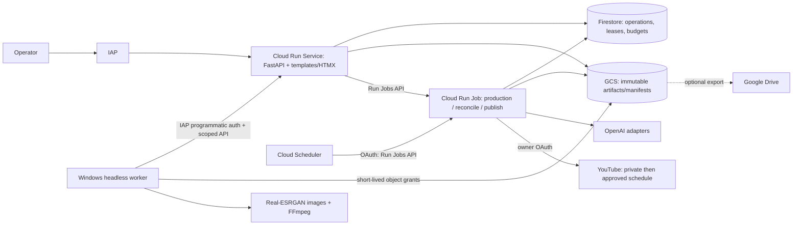
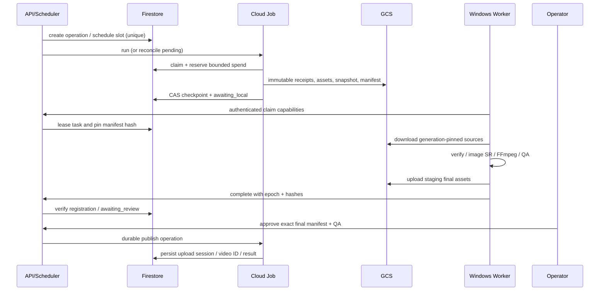

# Docelowa architektura cloud/hybrid

Status: **PROPOSED**, 2026-10-28. Wszystkie nowe kontrakty i ścieżki poniżej są propozycją. Stan istniejący opisuje [audyt](CURRENT_STATE_AUDIT.md).

## Granice i przepływ

Modularny monolit Python, jeden obraz dla API i batch entrypointu, osobny proces Windows z opcjonalnym GPU. UI i API w jednym prywatnym Cloud Run Service; produkcja w jednym Cloud Run Job (jedna task na execution). GCS jest źródłem prawdy dla immutable bytes; Firestore dla sterowania, widoków i historii operacji. SQLite pozostaje prywatnym formatem workspace wykonawcy i lokalnego workera, nigdy wspólną bazą instancji.



Nie potrzeba Cloud Tasks, Workflows, Pub/Sub, Kubernetes, mikroserwisów ani stale działającego koordynatora na tym etapie. Oddzielne deployment API/Job to role obliczeń, nie nowy silnik domenowy. Batch runner wywołuje istniejący AutomaticWorkflow z nowym driverem i istniejące application services dla dalszych etapów. CoreWorkflowEngine pozostaje dla obecnych klientów/presetów; nie wymuszać przepisywania workflow na drugą reprezentację.

## Konkretny model wykonania i trwałości

W pierwszym wdrożeniu zachować lokalne repozytoria projektu wewnątrz **prywatnego scratch workspace jednej execution**. To świadomy etap przejściowy, nie współdzielenie SQLite przez GCS. Równoległe instancje nie otwierają tego samego pliku. Firestore jest autorytetem dla aktualnego `workspace_snapshot_id`, `version`, lease i fencing epoch. Snapshot workspace to zamknięte/spójnie zbackupowane DB, manifest indeksów i referencje immutable mediów; snapshot nie zawiera sekretów, absolutnych ścieżek ani cache modeli.

Etap odtwarza ostatni snapshot lokalnie, materializuje wymagane media, działa pod jednym ownerem repozytoriów, a następnie:

1. Zapisuje nowe bytes i receipts w GCS kluczami create-only; streaming, generation precondition, checksum i limit rozmiaru.
2. Publikuje immutable stage manifest i kompletny snapshot przez upload do nowych kluczy. Snapshot pobiera spójny stan wszystkich DB pod quiescent ownerem; nie kopiuje otwartego journalu na ślepo.
3. W transakcji Firestore sprawdza lease token/epoch, oczekiwaną wersję i wejściowy snapshot; ustawia output manifest/checkpoint i nowy head. Brak transakcji obejmującej GCS i Firestore.
4. Awaria przed commit zostawia nieogłoszone obiekty; recovery adoptuje tylko dokładny request fingerprint z potwierdzonym receipt, albo kwarantannuje. Stary writer może zostawić bytes, ale nie zmieni head po utracie lease.

Dla płatnych operacji receipts muszą trafiać do GCS/Firestore zaraz po odebraniu wyniku, przed większym snapshotem etapu; checkpoint wyłącznie co etap nie wystarcza. Transakcje Firestore nie zawierają sieciowych wywołań providerów. Klient API widzi read models z Firestore i immutable script/media JSON z GCS. Nie otwiera DB batcha. Edycja/select/regenerate to durable command z `expected_version`, obsługiwany seryjnie w kolejnej execution; gdy potrzebny jest review, job zapisuje checkpoint i kończy, zamiast czekać bezczynnie na człowieka lub PC.

Alternatywa późniejsza: zastąpić poszczególne repositories adapterami dokumentowymi przy zachowaniu kontraktów. Nie jest potrzebna do pierwszego poprawnego przepływu. Kryterium odejścia od snapshotów: rzeczywisty koszt materializacji, potrzeba jednoczesnej edycji albo rozmiar przekraczający zmierzony scratch budget; nie sama liczba kanałów.

### Stany i idempotencja

`ProductionRun`: `queued → running → awaiting_local/awaiting_review → ready_to_publish → publishing → completed`; dodatkowo `blocked_budget`, `blocked_configuration`, `retry_wait`, `failed`, `canceled`. Stan biznesowy i stan Cloud Run execution są osobne. `StageAttempt`: queued/running/succeeded/failed/interrupted/canceled z `attempt_no`, `lease_token`, `fencing_epoch`, `lease_until`, heartbeat, input/output fingerprints i structured error. `StageResult` jest immutable.

Klucz harmonogramu: `(channel_id, schedule_revision_id, scheduled_at_utc)`; zachować oryginalny slot, nie czas retry HTTP. Klucz ręczny: `(principal_id, route, Idempotency-Key)`, z hashem payloadu; powtórzenie tego samego zwraca tę samą operację, inny payload daje 409. Retry etapu tworzy attempt tego samego logicznego request, regenerate zmienia request revision/seed i wymaga nowego limitu wydatków. `stage_key = run_id + stage_name + output_slot + request_fingerprint`; slots obejmują osobno long i short-1/2/3. Zmieniony jeden Short nie unieważnia long ani pozostałych Shorts.

Lease: początkowo 5 minut, heartbeat co 30 sekund; wartości konfigurowalne i testowane fake clock. Każdy write head i budget reservation wymaga aktualnej epoki. Utrata lease zatrzymuje nowe płatne działania. Claim obejmuje także publication continuation; wyścig dwóch executions kończy się jednym ownerem. Po utracie sieci aktywny worker może dokończyć plik lokalnie, ale nie może ogłosić go jako aktualny.

Retry: maksymalnie 3 dla bezpiecznych transferów/probe, exponential backoff z jitter i deadline; 429 respektuje Retry-After. Paid calls: domyślnie najwyżej 2 uprzednio zarezerwowane attempts, bez automatycznego ponawiania statusu `billing_unknown`. Timeout po dispatch może oznaczać wykonane i naliczone żądanie. Nie obiecywać exactly-once ani idempotency API tam, gdzie provider jej nie gwarantuje. `billing_unknown` i niejednoznaczny upload wymagają reconciliation/operatora. Błędy validation/schema/unsupported model/auth revoked są permanent/configuration, nie nieskończenie retryable.

### Dispatch bez zgubionych operacji

API zapisuje operation + `dispatch_pending` transakcyjnie, zwraca 202 i próbuje wyłącznie krótkiego `Jobs.run` (nie inference). Błąd dispatch nie usuwa operacji. Jeden Scheduler uruchamia ten sam Job w trybie `reconcile` raz na godzinę: odbiera pending commands, wygasłe lease i należne sloty kanałów, z limitami i claim. Tryb `produce --operation-id` lub `publish --operation-id` uruchamia ten sam obraz/Job przez override argumentów. API ma minimalne `run.jobs.runWithOverrides` tylko na tym Job, bez prawa zmiany obrazu/SA; runtime job nie dostaje deployer rights. Reconcile może wykonywać ograniczoną kolejkę w bieżącej execution bez samodzielnego fan-out.

Scheduler używa OAuth do Google Run API, nie OIDC z błędnym audience. Tygodniowy slot tworzy się po stronie reconcile z timezone kanału; dokumentować DST, missed-slot grace (propozycja 24 h), jedno nadrobienie, bez lawiny po tygodniowej awarii. Scheduler jest początkowo paused. Opcjonalny osobny weekly Scheduler wywołuje ten sam Run Job dla dokładnego czasu startu. Hourly tick daje recovery do około godziny plus lease expiry; owner zatwierdza ten początkowy SLO. Retry dispatch z API można wykonać od razu. Jobs mają minimum minutę naliczania na execution, więc częsty polling ciężkim profilem batch jest kosztowny. Jeśli potrzeba szybszego recovery, rozważyć później krótki authenticated API reconcile lub mały dispatcher z osobną wyceną.

## Etapy produkcyjne

| Etap | Wejścia / wynik / checkpoint |
| --- | --- |
| Topic/research | Pinned channel profile, historia tematów, whitelist źródeł → brief, źródła i topic reservation; MVP może brać zatwierdzony topic queue zamiast niezweryfikowanego automatycznego research |
| Plan/script | Brief → VideoPlan + ScriptRevision + continuity review; osobne utrwalone grupy, ograniczone naprawy długości |
| Narration | Approved spend policy + section revisions → Speech responses/chunks/WAV + receipt per call; nie scalać TTS chunk z NarrativeSegment |
| Scenes/assets | Accepted scene plans + narration timing → RenderScene, images/prompts, rational motion/timeline; cloud może odroczyć neural motion master do local |
| Cloud render | Pinned timeline + staged assets → preview/intermediate, opcjonalnie final FHD; FFmpeg sizing/crop jest zwykłym skalowaniem, oznaczonym jako takim |
| Shorts | Long source + alignment/metadata → co najmniej 3 niezależne portrait candidates przez repurpose, bez paid director rewrites; brak trzech poprawnych daje partial/review, bez sztucznego success |
| QA/handoff | Decode/probe/audio/caption checks → raporty i immutable handoff manifest; preview i final mają oddzielne QA identity |
| Local finish | Wybrany handoff → obrazy po Real-ESRGAN, ten sam frozen timeline, final long/Shorts i raporty; missing worker nie powoduje ponownej generacji |
| Package/publish | Exact final hashes + aktualny review → osobne pakiety long/Shorts, private uploads, thumbnail, captions, schedule po approval |

QA: 1920×1080 landscape 16:9 i 1080×1920 portrait 9:16, square pixels, rotation=0; nie wystarczy tag orientation. Initial channel policy: long 600 s ±10%, Shorts 30–60 s jako własny target, nie deklaracja maksymalnego limitu platformy. Walidować sample/frame map, A/V drift ≤0.1 s, clipping/pełne decode, napisy wewnątrz lokalnego czasu klipu i safe-area; propozycja audio −16 LUFS ±1, true peak ≤−1 dBTP zgodna z obecnym QA default, nie wymaganie YouTube. Reuse istniejących validatorów; nie obniżać ich progów dla przejścia migracji. Ocena narracji, praw do materiałów, oryginalności i wartości redakcyjnej pozostaje oddzielną decyzją człowieka.

## Kontrakty danych

Firestore kolekcje: `channels`, `channel_revisions`, `schedules`, `runs`, `operations`, `stage_attempts`, `stage_results`, `approvals`, `budget_reservations`, `usage_receipts`, `workers`, `worker_tasks`, `publications`. Zapytania UI są stronicowane i filtrowane po owner/channel; duże prompty/timelines/evidence w GCS, nie jednym rosnącym dokumencie Firestore. Każdy run pin: profile/schedule revision, config schema, provider model/settings, pricing version, approval policy, input snapshot, code SHA i image digest. Brak prywatnych ścieżek w publicznych DTO.

`ChannelProfile`: owner subjects, name, language=en, editorial topic policy/queue, banned/recent topics, Standard 600 s, long/Shorts metadata templates, voice/style, image settings, branding revision, 16:9/9:16 output profiles, weekly count 1+3, schedule IANA timezone, worker affinity, spend caps i publishing mode. ChannelLibrary branding to tylko część tego modelu. Harmonogram produkcji i publikacji osobne; wszystkie instants UTC z zachowanym timezone/slotem. Edycja konfiguracji tworzy revision i wpływa na przyszłe runy; bieżący run wymaga jawnego rebase.

Przykład **proponowanego**, skróconego manifestu handoff:

```json
{
  "schema_version": 1,
  "manifest_id": "manifest_opaque_id",
  "run_id": "run_opaque_id",
  "revision": 1,
  "purpose": "local_finish",
  "parent_manifest_sha256": null,
  "request_fingerprint": "sha256:<canonical request>",
  "workspace_snapshot_id": "snapshot_opaque_id",
  "timeline_artifact_id": "timeline_opaque_id",
  "renderer_profile": "fhd-motion-v1",
  "artifacts": [{
    "artifact_id": "asset_opaque_id",
    "role": "scene_source",
    "storage_key": "runs/run_opaque_id/assets/asset_opaque_id.png",
    "generation": "<GCS generation>",
    "sha256": "<64 hexadecimal characters>",
    "size_bytes": 123456,
    "media_type": "image/png",
    "depends_on": ["scene_revision_id"]
  }],
  "outputs": [{"slot": "long", "width": 1920, "height": 1080}],
  "required_capabilities": ["image_upscale", "ffmpeg_motion_v1"],
  "approval_refs": ["spend_policy_revision_id"]
}
```

Pełny kontrakt musi dodatkowo zawierać autorstwo/schema/code/runtime/model digests, asset lineage, frame/sample/rational timebase, clipping/crop/motion i caption map oraz retention class. Manifest bez własnego hash w treści; canonical bytes hash zapisywany w transakcyjnym head/worker assignment i zaufanej odpowiedzi API. Worker ufa temu kanałowi HTTPS/auth, nie samemu plikowi z Drive; Drive mirror weryfikuje pinned hash z API. Nie wkładać signed URLs, OAuth tokenów ani dowolnych executable/ścieżek do manifestu. Final manifest ma własną wersję/hash, parent handoff hash, pochodzenie upscale, nowe output IDs i QA refs. Nigdy nie nadpisuje poprzedniego.

Retencja: domyślnie zachować selected/rejected/history/approval/lineage i oryginalne source media. Tymczasowe scratch i nieogłoszone obiekty można sprzątać po 7 dniach tylko po reconciliation; proposal wymaga akceptacji. Final/source domyślnie bez automatycznego TTL. Mark-and-sweep z pin/reachability i grace period, raport dry-run; GCS lifecycle nie może sam usuwać potrzebnych zależności. Firestore backup/PITR i GCS soft delete nie zastępują testowanego restore. Historyczne identyfikatory zachować także po imporcie desktop.

## API i interfejs web

Wybrać FastAPI + Jinja2/HTMX z małym modułem JS dla odtwarzacza/progress. Templates w `backend/app/web/templates`, static w `backend/app/web/static`; `frontend/` niepotrzebny na początek. Polling widocznej strony co 5–15 s z backoff; żadnego background production w procesie HTTP ani potrzeby stale otwartego browsera.

Nowy namespace `/api/v2`; stare `/api/v1` zachowuje dotychczasowe kontrakty lokalne, ale jego paid/mutation routes nie są wystawiane w cloud composition. JSON proponowany camelCase zgodny z istniejącym HTTP, domena Python snake_case. OpenAPI/contract fixtures kontrolują mapowanie.

| Trasa | Wynik i uprawnienia |
| --- | --- |
| `GET/POST /api/v2/channels`, `GET/PATCH /channels/{id}` | Owner/read, revision + If-Match dla edycji |
| `GET/PUT /channels/{id}/schedules/{scheduleId}` | Wersjonowany schedule, owner; paused default |
| `POST /channels/{id}/runs` | Owner, Idempotency-Key, policy/profile revision → 202 operationId/runId/Location |
| `GET /runs`, `/runs/{id}`, `/runs/{id}/stages`, `/runs/{id}/events` | Paginacja, progress, errors, lease i output slots |
| `POST /runs/{id}/commands` | retry/cancel/select/regenerate z expectedVersion, scope i kosztowym grantem; 202 |
| `POST /runs/{id}/approvals` | Append-only decision, exact manifest/QA/config hash, actor/reason; brak approval stale |
| `GET /runs/{id}/artifacts`, `GET /artifacts/{id}` | Metadane i dependencies, channel scope |
| `POST /artifacts/{id}/access` | Krótki grant download dla konkretnej generation; owner lub assigned worker |
| `GET /operations/{id}` | queued/dispatch pending/result/error, terminal failure bez ukrycia |
| `GET /workers`, `POST /worker/heartbeat`, `/worker/tasks:claim` | Scoped worker principal; capabilities/version/free disk |
| `POST /worker/tasks/{id}/progress`, `/upload-grants`, `/complete`, `/fail` | Lease token + manifest hash + epoch; nie dowolny job/run |
| `POST /channels/{id}/oauth/start`, `GET /oauth/youtube/callback` | Owner browser OAuth state/PKCE, channel identity verification |
| `POST /runs/{id}/publications` | Owner + final approval → 202 private upload operation |
| `PATCH /publications/{id}/schedule` | Owner, expectedVersion, approved future publishAt → 202 |
| `GET /calendar`, `/publications`, `/system/status` | Zbiorczy widok channel scope; bez sekretów/tokenów |

Błędy: 401/403 auth, 404 także dla obcego zasobu, 409 idempotency/version/lease, 422 schema, 429 rate, 503 storage/config unavailable. Odpowiedź `code`, bezpieczne `message`, `correlationId`, `retryable`, bez raw provider payload i lokalnych paths. 202 nie twierdzi, że produkcja rozpoczęła inference. HTTP requests mają krótkie timeouty; SSE optional później.

UI M2: dashboard + queue + run detail + artifacts/previews + approval + profile/settings + koszt estimate/reserved/known/unknown. M4 worker status i actionable missing-worker. M5 calendar/publishing/error history. Regeneracja tylko wspieranych scope, z nową rewizją i estymacją; UI nie udaje pełnego desktop editor. Skrypt i media można review bez modyfikowania aktualnego workspace. Responsive layout, desktop jako główny ekran pracy.

## Security i worker

Direct IAP chroni wszystkie ścieżki Cloud Run, także run.app/static/media/API. Aplikacja sprawdza podpis, issuer, audience, exp i subject IAP JWT, a następnie role owner/viewer/worker; nie ufa unsigned email header. Browser writes wymagają same-origin/CSRF token; callback OAuth ma state i PKCE, bez logowania code. Brak wildcard CORS i public paid endpoints. Preview: private GCS + krótki object/generation-bound signed GET po kontroli dostępu; URL jest bearer grant z TTL np. 5 min, nie logować go. Alternatywa proxy z HTTP Range, gdy wymagana natychmiastowa revocation.

Windows worker: jeden niezależny proces `python -m app.local_worker`, Task Scheduler logon/start/restart-on-failure, bez PySide6. W SQLite zapisuje assignment/manifest hash/fingerprint, partial download offsets, artifact digests, stage results, upload session refs i attempts. Pobiera do `.partial`, po pełnym SHA i decode przenosi atomowo. Wznawia tylko generation-pinned range; zmiana generation unieważnia partial. Unique `(task_id, manifest_hash, finishing_profile)` i cloud claim uniemożliwiają ponowne ogłoszenie tego samego wyniku. Lokalne cache po source hash+model/runtime/profile; nie uważać istniejącego MP4 za completed bez verify.

Auth proponowane dla jednego prywatnego PC: dedykowana tożsamość **użytkownika workera** z OAuth programmatic access IAP, krótki ID token i refresh credential zabezpieczony Windows Credential Manager/DPAPI. Operator raz autoryzuje worker; browser nie jest potrzebny później. Ten principal ma w aplikacji tylko worker routes i przypisane kanały; API nie nadaje mu praw właściciela nawet gdy IAP wpuszcza do serwisu. Custom OAuth client/programmatic allowlist i działanie refresh po restarcie wymagają realnego testu przed M4. Brak JSON service-account key. Jeżeli właściciel nie ma osobnej tożsamości lub OAuth nie działa unattended, CLOUD-022 pozostaje blocked acceptance i wymaga jawnego wyboru device pairing z rotowanym credential albo innego federowanego rozwiązania; nie osłabiać IAP w celu obejścia.

Worker nie ma bucket-wide IAM: API wydaje krótkie grants dla konkretnych input generations i do staging prefix przypisanego task/attempt. Serwer weryfikuje rozmiary/hash/media i rejestruje wynik przed final manifest. Upload sessions/grants traktować jak sekret; nie zapisywać ich do public manifestu. Revocation identity/task działa dla nowych żądań, wydany URL wygasa po TTL. Zła ścieżka, zip-slip, symlink/reparse, nadmiar bytes i nieznana schema są odrzucane przed uruchomieniem FFmpeg. Command line buduje zaufany runtime z allowlist, nie shell z manifestu.

Worker offline: run `awaiting_local`, heartbeat age widoczny; po np. 24 h alert. Operator może jawnie wybrać cloud FHD fallback, z nowym final manifest i QA/review. Nie publikować preview jako final bez nowej decyzji. Cloud nie czeka z włączonym CPU.

## Model finishing i publikacji

| Model | Reuse, koszt i ograniczenia | Rekomendacja |
| --- | --- | --- |
| A: cloud MP4 → local video finishing | Prosty transfer jednego MP4, FFmpeg loudness/captions/transcode działa; neural video SR wymaga nowego adaptera i setek tysięcy frames, temporal QA i większego kosztu | Tylko prosty transitional MVP bez deklaracji AI video upscale |
| B: cloud sources/timing → local image SR + final render | Reuse ImageUpscaleService/Real-ESRGAN i frozen motion/timeline; kilkadziesiąt obrazów zamiast 18 tys. frames dla 10 min/30 fps; więcej plików/wersji do materializacji | Główny model docelowy; local FHD najpierw, 4K dopiero po benchmarku |

Przejściowy MVP: cloud tworzy poprawny final FHD przez zwykły FFmpeg scale/crop; local opcjonalnie normalizuje lub wypala captions. Wyraźnie zapisać `upscale_method=ffmpeg_resize` albo `realesrgan_image` w provenance. Nie wymagać GPU do cloud preview; obecny warunek motion-master dla non-draft musi stać się profile capability/policy zamiast fałszywego mock upscale. Long i Shorts zachowują ten sam timing i zmieniają tylko pinned obraz/finishing revision. Alignment można wykonać lokalnie i zwrócić z wersją; bez alignment nie deklarować word-synchronized captions.

Worker zwraca final assets do GCS. Cloud publisher trzyma OAuth i upload ledger; YouTube credentials nie trafiają na PC. Oddzielne rekordy publikacji long/Shorts z `(channel_id, final_video_sha256, metadata_revision, target)` oraz single upload lease. Private upload jest pierwszym trybem. Grant generacji nie daje prawa publikacji. `publishAt` tylko future UTC, private/never-published, po aktualnej approval, sprawdzić przed wysłaniem; nie wysyłać daty z przeszłości. Caption/thumbnail retry używa istniejącego video ID, nie nowego videos.insert. Zapis resumable URI/offset, bez wycieku do logów. Niejednoznaczny sukces upload blokuje nowe insert do reconciliation; API YouTube nie daje uniwersalnego exactly-once key. TikTok: MP4+thumbnail+SRT+metadata/instructions w export package; direct post DEFERRED, zależny od eligibility/audytu platformy.



Źródła kontraktów publishing sprawdzone 2026-10-28: [OAuth YouTube](https://developers.google.com/youtube/data/guides/authentication), [resumable upload protocol](https://developers.google.com/youtube/data/guides/using_resumable_upload_protocol), [video status/publishAt](https://developers.google.com/youtube/data/reference/rest/v3/videos), [thumbnail upload](https://developers.google.com/youtube/data/reference/rest/v3/thumbnails/set), [caption upload i scopes](https://developers.google.com/youtube/data/reference/rest/v3/captions/insert). [TikTok Direct Post](https://developers.tiktok.com/docs/en/content-posting-api-get-started) wymaga odpowiednich uprawnień i audytu klienta dla zdjęcia ograniczeń widoczności. Zgodność konta/aplikacji nie została potwierdzona; nie jest to zależność eksportowego MVP.

## Proponowane drzewo i współdzielenie

```text
backend/app/
  domain/                 # istniejące modele + production_run/manifest/channel_profile DTO
  application/            # istniejące usługi; headless driver, budget, runner ports
  providers/              # istniejące OpenAI/FFmpeg/YouTube; lazy factories
  storage/                # lokalne repo; nowe workspace_snapshot i cloud ports
  workflow/               # zachowany silnik/presety; bez GCP/Qt
  jobs/                   # lokalny JobCoordinator; cloud nie zastępuje jego SQLite w miejscu
  api/                    # istniejące v1; nowy v2/router/dependencies/auth
  web/templates/          # Jinja2 widoki
  web/static/             # CSS, przypięty HTMX, mały JS bez zewnętrznego CDN
  cloud/
    __main__.py           # produce/reconcile/publish, headless composition
    composition.py        # SDK i factories tylko tutaj/adapterach
    repositories.py       # Firestore control state, CAS/lease/ledger
    artifacts.py          # GCS streaming/generation
    dispatcher.py         # Run Jobs API, durable pending dispatch
  local_worker/
    __main__.py           # niezależny proces, polling/backoff
    composition.py        # Windows executable/GPU factories
    repository.py         # lokalne checkpointy SQLite
    client.py             # scoped API/auth, transfer
  desktop/                # obecny editor i compatibility facades
  runtime/                # media process współdzielony; Windows/GPU lazy/local-only
infra/gcp/                # Terraform jeden deployment + backend state, brak tfstate w Git
scripts/cloud/            # config validation, build/deploy/smoke/rollback
scripts/local_worker/     # Task Scheduler install/run/diagnostics bez sekretów
.github/workflows/        # PR checks i jedna chroniona ścieżka delivery
```

Nie przenosić masowo pakietów. Wspólne dla desktop/cloud/local: domain, timeline/render/caption/QA/image-upscale application services, provider contracts i plikowy staging z jawnie przekazaną konfiguracją. Cloud-only: Firestore control plane, GCS, Scheduler, OAuth vault/publisher. Local-only: CUDA/runtime provisioning, DPAPI i autostart. Desktop zachowuje import compatibility przez fasady; kierunek zależności application → port, composition → adapter, nigdy application → widget/GCP SDK.
