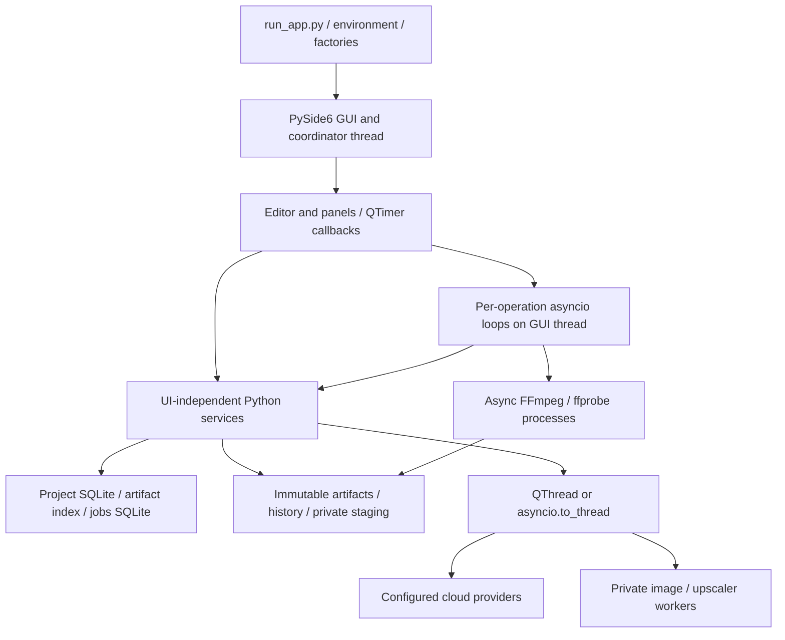
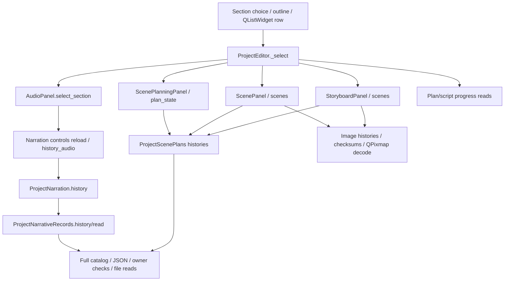

# AI Content Studio: performance and architecture audit

Audit date: 2026-10-17 (Europe/Warsaw). Scope: actual local checkout, audit only.

## A. Executive summary

**Verdict: OPTIMIZE DESKTOP.** Multi-second GUI starvation is reproducible without network requests, GPU inference or a production export. Keep PySide6 and the reusable Python services. Correct artifact access and redundant refreshes first, then move remaining blocking provider/media phases behind existing worker boundaries. A complete web rewrite is not justified by the observed faults.

The largest measured problems were:

1. **Eager optional runtime verification:** image catalog composition took **80.133 s** and upscaler composition/verification **97.913 s**, before window construction. Actual model inference is deferred, but installed runtime/model file verification is not. No Torch, torchaudio, diffusers or transformers module was imported into the measured application process.
2. **Catalog-wide reads multiplied by retained history:** reading 20 narration reservation records at 10,000 artifacts took **8.740 s median**, with **41 complete catalog scans and 410,000 manifest reconstructions**. Existing ID/key indexes are unused by these reads.
3. **Scene/history and panel amplification:** a genuine section switch in a temporary 20-section/80-scene partial project took **1.838 s median**. One callback delayed a 5 ms Qt heartbeat by **2.158 s**. It performed 310 catalog scans and 1,887 traced SQL statements.
4. **Uncoalesced diagnostics:** three queued requests ran three times and occupied **18.502 s**. One inspection performed **1,027 catalog scans and 6,399 SQL statements**, despite only 81 registered artifacts.
5. **Synchronous preparation before FFmpeg:** staging 80 repeated synthetic FHD clips took **21.008 s**, without starting an encoder. Render and proxy call paths execute this work synchronously inside GUI-pumped coroutines.

Generate Plan and Regenerate Prompt also contain synchronous provider calls on the GUI thread. A deliberately delayed offline provider reached through Generate Plan caused a **209 ms heartbeat gap**; this measures scheduling, not real API latency.

The default cloud-audio/selective-regeneration composition has a separately reproduced compatibility error: it expects `audio.production`, which CloudAudioServices does not supply. This limits claims about the fully composed current render workflow; it is not evidence of a freeze.

Measurements demonstrate event-loop starvation, not Windows' exact “Not Responding” presentation. Production-project opening, a fully completed ten-minute project, real API latency, GPU contention and full export wall time remain **NOT MEASURED**. No fixes were implemented.

## B. Actual baseline and current architecture

### Checkout and environment

| Item | Observed baseline |
| --- | --- |
| Repository | `D:\Projects\ai-content-generation` |
| Branch | `fix/openai-narration-attempt-recovery` |
| HEAD | `22fdd478d465bc0bd53193b97f110dbed6e9c9c4` |
| Initial working tree | Clean; `git status --short` returned no entries |
| Recent inspected changes | HEAD D079 recovery; parent `381e6f0` D078 OpenAI narration; `4ba0930` D077 duration-repair merge |
| Interpreter used | Repository `.venv\Scripts\python.exe`, CPython 3.11.9, 64 bit |
| OS reported by Python | Windows build 22631, AMD64 |
| PySide6 / Qt | 6.11.2 / 6.11.2 |
| Runtime packages | pydantic 2.13.4; Pillow 12.3.0; openai 2.54.0; python-dotenv 1.2.3 |
| Test runner | pytest 9.1.1 |
| Entrypoint | `python run_app.py` → `app.desktop.__main__.main()` |
| Integrations observed through composition | OpenAI LLM object; two configured image catalog options; local image/upscaler activation pointers; LocalUpscaleProvider; FFmpeg and ffprobe found |
| Configuration handling | Optional checkout `.env` or explicitly selected file; process environment preserved; credentials and environment values omitted |

No assumption was made about matching `master`, GitHub state or release acceptance. No fetch was needed: local source and HEAD are authoritative for this audit. `docs/architecture/`, ADR 0003 and the desktop implementation plan were inspected. Task IDs and historical documentation were not treated as implementation evidence. This report-only audit does not select or implement a D### task.

### Features actually present locally

| Feature | Code evidence and qualification |
| --- | --- |
| OpenAI TTS replacement | `desktop/product_composition.py:76-89` constructs cloud narration; `desktop/cloud_audio.py` implements settings, paid-attempt ledger, threaded synthesis/validation and owner-thread publication. Legacy optional runtimes remain. No paid call made. |
| Narration recovery | `cloud_audio.py:111-261`, `desktop/narration_recovery.py`, `storage/narration.py`: retained-response/chunk evidence, eligibility and reviewed exceptional retry. Snapshot creation still blocks the owner thread. |
| Automatic workflows | `application/automatic_workflow.py:103` and `desktop/pipeline_driver.py`: readiness/resume, provider offloading, duration gates and scene/timeline stages. |
| Lazy GPU/upscaler | `_verified` avoids repeated installation verification on one provider instance; inference runs in private workers. Startup factories still eagerly call capabilities and verify installed trees. |
| Duration repair | `application/duration_repair.py`, `storage/duration_repairs.py`, `pipeline_driver.py:151-196` and Video Plan controls implement opt-in measured repair. Provider work is offloaded; measurement/history/UI work remains on the owner thread. |
| Render/export | `application/video_render.py`, `storage/video_render.py`, `providers/ffmpeg_render.py`, preview/finishing/delivery adapters and ExportPanel implement actual media paths. Default cloud/regeneration composition has the compatibility failure described below; full export acceptance is not asserted. |

All code paths in this report are relative to `backend/app/`, unless otherwise specified. Source line references describe this exact HEAD.

### Execution and persistence boundaries



Widgets call services directly. SQLite repositories enforce coordinator-thread ownership. The desktop does not require a local HTTP server. FastAPI is an optional adapter, not a demonstrated drop-in backend for every current desktop operation. The older workflow engine stays provider-neutral; desktop Automatic uses DesktopPipelineDriver.

Separate databases hold project/editorial revisions, artifact manifests/result selections and durable jobs. `ProjectRepository._connect` (`storage/project_repository.py:98-113`) uses `timeout=0`, `synchronous=FULL` and EXCLUSIVE locking. Artifact and queue adapters open short-lived connections and validate ownership/schema. D040 attaches the queue for atomic result registration/selection. Moving live repositories into arbitrary worker threads would violate this contract.

Editor and media panels create separate asyncio loops for active operations. Qt timer callbacks call `call_soon(loop.stop); loop.run_forever()` on the GUI thread. That executes a ready callback batch, not a bounded time slice. An async function can run synchronous storage, validation, image conversion or hashing for seconds before yielding. QThread/to_thread offload many provider calls, but not all preparation/publication work.

## C. Confirmed performance findings

P1 means observed severe responsiveness/startup cost or a confirmed unbounded blocking path. P2 means a secondary cost or confirmed path whose production impact still needs measurement. No P0 incident, data corruption or deadlock was established. A confirmed blocking path is distinguished from a measured production latency.

### PERF-001 — Optional runtime verification blocks pre-window startup (P1)

- **File/function/lines:** `desktop/__main__.py:57-72`; `desktop/image_generators.py:39-84` (`compose_installed_image_generators`); `desktop/image_composition.py:57-73` (`compose_installed_upscale`); `runtime/local_image_runtime.py:58-96,121-149` and `runtime/upscale_runtime.py:28-56,71-99` (`_inventory`, `_packages`, `active`).
- **Call path/thread:** launch → environment → QApplication → image catalog → local capabilities → active installation → recursive runtime/model inventory and hashing → package-metadata subprocess. Upscaler composition verifies its installation too. All synchronous on the launcher/GUI thread, before editor construction/show.
- **Conditions/frequency:** each start with those configured installed runtimes. A configured local image root is considered even when a different generator is preferred. Provider `_verified` helps later calls, not the first verification.
- **Measurements:** catalog 80,132.953 ms; upscaler 97,913.174 ms, single run. Import 387.680 ms and LLM construction 0.259 ms. Individual hash/model/package subphases were not timed separately.
- **Root cause/evidence/confidence:** capability verification is coupled to pre-window composition. **High.** No relevant Torch/GPU modules were imported into the measured process; this is file verification, not evidence of model loading or inference. Host I/O activity was not controlled.
- **Minimal proposed fix:** show the shell first, present checking/unavailable provider states, verify optional installations asynchronously before use. Retain receipts/integrity checks and explicit invalidation; descriptors should not recursively hash installed trees.
- **Regression risks:** enabling unverified providers, trusting changed runtimes, auto-selecting a different provider, verifier cancellation/shutdown races. Do not simply remove verification.

### PERF-002 — Single-file access reconstructs every manifest (P1)

- **File/function/lines:** `storage/local_store.py:215-240` (`open_artifact`, `open_artifact_id`, `list_artifacts`, `_registered`); `storage/artifact_index.py:46-77` (`_connection`, `manifests`).
- **Call path/thread:** GUI/service → read_artifact(key) → open_artifact → list_artifacts → SELECT every manifest → JSON/coercion/sort → membership check → one file open. ID access also enumerates first. Prefix filtering happens after the full catalog load. It runs on the caller's thread, often Qt's.
- **Conditions/frequency:** every point read, multiplied by narration/scene/history/preview operations.
- **Measurements:** N=10,000: list median 192.628 ms; key read 219.626 ms; ID open/close 210.507 ms. Direct ID SELECT using the existing index on an already-open connection: 0.037 ms median. That microbenchmark excludes connection guards, JSON construction, path checks and file I/O; it is not an end-to-end speedup claim.
- **Root cause/evidence/confidence:** O(N) Python work for an indexed identity/key predicate; EXPLAIN confirms suitable indexes already exist. **High.**
- **Minimal proposed fix:** owner-checked index methods for manifest by ID/key, used by project-backed store point reads. Preserve legacy sidecars and containment checks. No new index required for these predicates.
- **Regression risks:** bypassing project ownership, exposing unregistered files, changed unknown-key behavior, legacy/result-index incompatibility. Recommended first PR.

### PERF-003 — Narration history produces O(NH) catalog work (P1)

- **File/function/lines:** `storage/narration.py:50-76` (`history`, `project`, `settings`); `storage/narrative_reviews.py:20-35` (`history`, `read`); `desktop/narration_panel.py:94-114` (`reload`); `desktop/audio_panel.py:199-207,321-330`; `desktop/cloud_audio.py:488-506` (`history_audio`).
- **Call path/thread:** section selection → AudioPanel.select_section → settings reload → settings/budget/migration/reservation/usage histories → complete list → each record revalidates manifest with another list → read_artifact lists again. Entirely synchronous on GUI. The UI shows the last eight usage entries only after loading all entries.
- **Conditions/frequency:** section selection, audio binding/settings save, audio/recovery completion, and chunk preparation/reservation. Retention increases work even for undisplayed history.
- **Measurements:** H=20 causes `1 + 2H = 41` catalog scans: median 221.701 ms at N=100; 1,527.055 ms at N=2,000; 8,739.559 ms at N=10,000. At N=10,000 cProfile recorded 410,000 manifest reconstructions and about 20.2 million calls. Profile time 17.736 s includes profiling overhead and is separate from medians.
- **Root cause/confidence:** O(NH), quadratic when history grows proportionally to N; repeated project/override queries amplify it. **High.**
- **Minimal proposed fix:** after indexed point reads, filter metadata once and read each retained record once; share project/section/ledger data in an immutable operation snapshot. Page visible usage without discarding authoritative attempt/budget evidence.
- **Regression risks:** missing historical attempts, stale spend ceilings or retry eligibility, override/migration mistakes, changed append-only ordering. Preserve all approvals and attempts.

### PERF-004 — Scene history is globally parsed before scope filtering (P1)

- **File/function/lines:** `storage/scene_plans.py:38-84,105-118` (`_read`, `history_records`, `_history`, proposals/acceptances/timings); `desktop/scene_services.py:115-141,176-238`; `storage/scene_images.py:77-136`; `desktop/scene_panel.py:203-224`.
- **Call path/thread:** section selection → ScenePlanningPanel.plan_state, ScenePanel.scenes and StoryboardPanel.scenes → history_records reads all records of the kind across the project → _history filters section/revision afterward → load(value.id) reads matching records again and resolves parent plans. Each _read itself causes two catalog scans. Per-scene image selections/history validate historical variants and lineage. Runs on GUI/coordinator thread.
- **Conditions/frequency:** selection/storyboard refresh, diagnostics, timeline candidates and regeneration graph construction.
- **Measurements:** genuine large-partial row switch: 310 scans / 25,110 reconstructed manifests / 1,887 SQL statements / 310 new connections. Separate cProfile sample: _select 3.149 s; catalog listing 2.852 s cumulative; scene _history 1.908 s cumulative. Cumulative values overlap and must not be added.
- **Root cause/confidence:** irrelevant history payloads loaded before relevance filtering, repeated resolution and per-scene validation cause N+1 amplification. **High.** No old revisions or valid narration were needed to expose it.
- **Minimal proposed fix:** filter known project/section/revision metadata before payload resolution; share an operation-scoped catalog/record map and resolved scene views across panels.
- **Regression risks:** hiding relevant corruption, silently falling back to older records, stale acceptance/timing/view state, losing selection-chain validation. Preserve unknown/current corruption rules and historical warnings.

### PERF-005 — Full diagnostics are repeatedly queued and propagated (P1)

- **File/function/lines:** `desktop/editor.py:318-337,360-373,499-546,754-783`; `desktop/video_plan_panel.py:387-431`; `desktop/timeline_panel.py:73-100`; `application/pipeline_diagnostics.py:84-353`; `desktop/timeline_composition.py:64-110`.
- **Call path/thread:** load/_refresh → selection/panel reads → VideoPlanPanel._render emits plan_changed → queue diagnostics; timeline draw emits changed → queue diagnostics; _refresh also diagnoses directly. Each _queue_diagnostics creates another singleShot, without pending flag/debounce. Each diagnosis inspects all sections, timeline candidates/history, export state, and resolves current storyboard views again. GUI thread throughout.
- **Measurements:** opening instrumentation observed two Video Plan renders, seven storyboard set_section calls and five diagnostics calls over synchronous load plus first event drain. Three explicit requests yielded exactly three runs: minimal 467.237 ms; large partial 18,502.226 ms. A large inspection median was 6,072.438 ms; its later traced run performed 1,027 scans / 83,187 manifest reconstructions / 6,399 SQL statements.
- **Conditions/frequency/root cause:** multiple times on open and state changes. Automatic narration completion also directly diagnoses (`pipeline_driver.py:198-213`); script group completion calls broad _refresh. Redundant, nonincremental work is confirmed. **High.** Plain _select does not directly call diagnostics: its own reads already block, so not all selection latency should be attributed to diagnosis.
- **Minimal proposed fix:** coalesce pending requests, guard by session/revision, reuse one inspection/view snapshot, update storyboard status without resolving histories again; later invalidate affected stages/sections.
- **Regression risks:** missed final updates, stale readiness/export state, callbacks for a closed or different project, applying results to an older revision.

### PERF-006 — Synchronous provider requests remain in GUI handlers (P1)

- **File/function/lines:** `desktop/video_plan_panel.py:355-373` → `application/video_planning.py:55-99`; `desktop/scene_panel.py:423-425` → `desktop/scene_services.py:281-285` → `application/visual_prompts.py:41-43,81-86`; synchronous transport `providers/openai_llm.py:58-100,185`.
- **Call path/thread:** Generate Plan clicked → service.generate → provider.generate_structured → synchronous transport/JSON/retry. Regenerate Prompt clicked → _act → services.regenerate_prompt → prompts.generate → provider request. Both GUI thread. Legacy selective-regeneration prompt/image execute functions also call synchronous services inside async wrappers (`storage/regeneration.py:190-265`).
- **Measurements:** offline fake with deliberate 200 ms sleep then failure was reached on the GUI thread through Generate Plan: 207.848 ms callback / 209.282 ms maximum heartbeat gap. Real API latency, configured timeout/retry duration and prompt transport latency: **NOT MEASURED**.
- **Conditions/frequency/confidence:** every explicit request through these paths; production impact depends on provider latency. **High** for execution path. Plan-driven script groups/editorial review already use PlanGroupThread; Automatic prompt generation uses to_thread and should not be mislabeled synchronous network work.
- **Minimal proposed fix:** existing freeze → background provider call → owner validate/retain/select pattern, cancellation and stale-selection checks. No new orchestration framework.
- **Regression risks:** late results replacing new edits, duplicate paid dispatch, shared cancellation state and SQLite use from worker threads.

### PERF-007 — Render/proxy staging blocks before encoding (P1)

- **File/function/lines:** `application/video_render.py:28-72`; `storage/video_render.py:145-217` (`stage`, `_stage_clip`); `application/preview.py:67-86`; `storage/preview.py:38-39,94-151`.
- **Call path/thread:** Rebuild → RegenerationPanel.tick → run → prepare/identity → stage all clips → resolve timing/acceptance/image/history/audio → copy image and full section WAV → hash copied files → Pillow EXIF/RGBA/alpha/RGB/PNG conversion → only then await FFmpeg. Proxy uses the same staging boundary. Scene preview also stages synchronously from PreviewPanel.preview_scene.
- **Measurements:** actual adapter, synthetic FHD retained image/short PCM repeated 1/10/80 times: 246.903 / 2,493.518 / 21,008.002 ms. The 80 case wrote 240 files totaling 2,493,920 bytes. No encoder ran. This is repeated-input staging throughput, not an 80-unique-scene ten-minute export.
- **Conditions/frequency/root cause/confidence:** each render/proxy preparation, even when encoding is async. Serial validation/path checks/copies/conversions; section WAV copied per scene; no per-attempt deduplication. **High** for path and measured preparation; complete current render timing remains unmeasured.
- **Minimal proposed fix:** owner captures immutable identities/DTOs, worker performs bounded copy/hash/conversion, owner revalidates and publishes. Deduplicate identical immutable preparation where snapshot semantics allow. Progress/cancel during preparation.
- **Regression risks:** TOCTOU changes, altered EXIF/alpha/crop output, lost integrity gates, stale publication, cancellation/partial staging and resume semantics. Preserve failed diagnostic bytes.

### PERF-008 — Full-raster thumbnail preparation runs on GUI (P2)

- **File/function/lines:** `desktop/storyboard_panel.py:55-72,99-149`; `desktop/scene_panel.py:346-366`; `desktop/scene_services.py:413-416`; `desktop/preview_panel.py:178-193`; `desktop/quality_panel.py:165-170,178-184`.
- **Call path/thread:** card → image_bytes → image checksum/lineage validation → read bytes again → full QPixmap decode → scale to 150x84. Scene inspector repeats decode for 320x180; Quality evidence and scene preview decode synchronously too. Timeline itself is a text/table view, not another thumbnail decoder.
- **Measurements:** Qt decode + smooth 150x84 prep: FHD median 53.833 ms; 4K 173.341 ms; 4800x2700 297.373 ms. These exclude store/disk validation. Four selected FHD images/15 artifacts: sole-section reload median 1,324.184 ms, heartbeat gap 1,474.814 ms; this includes record/service overhead, not just decode.
- **Conditions/frequency/confidence:** uncached storyboard images, scene inspector changes and preview/evidence display. **High** for path and isolated decode cost; production native memory impact **NOT MEASURED**. Larger PNG benchmarks exceed the default 16 MiB source intake cap but fit the derivative 64 MiB cap.
- **Existing mitigation:** storyboard caches small scaled pixmaps by immutable ID, preserves cards when views are equal, and selection alone can reuse cached thumbnails. However set_section resolves services.scenes before comparing views. Cache clears on bind, otherwise has no eviction bound; actual cache growth was not measured. All cards of the selected section are created, including outside the scroll viewport.
- **Minimal proposed fix:** background QImage/precomputed thumbnail preparation keyed by checksum/size; QPixmap display on GUI. Bound cache; lazy visible-card loading only if still justified after storage fixes.
- **Regression risks:** stale results on project switch, orientation/color/alpha differences, QPixmap thread misuse and weakened integrity checking. No media UI rewrite justified yet.

### PERF-009 — “Async” recovery snapshots block before offload (P1)

- **File/function/lines:** `desktop/cloud_audio.py:239-261`; `desktop/audio_panel.py:250-279`; `desktop/editor.py:840-845`; `desktop/pipeline_driver.py:124-141`.
- **Call path/thread:** GUI-pumped recovery/estimate task → recovery_scan_async → evaluate self._scan_snapshot(sections).recovery_scan → heads/manifests/per-section settings/project/migration/four ledger histories/jobs → only then asyncio.to_thread. Arguments are evaluated before offloading.
- **Measurements:** large snapshot median 1,267.132 ms in initial series; later callback 1,187.024 ms / heartbeat gap 1,191.950 ms. File/evidence scanning afterward is threaded, but snapshot construction is not.
- **Conditions/frequency/confidence:** estimates, recovery, generation preflight, preview estimates and repeated Automatic authorization/preflight. **High.**
- **Minimal proposed fix:** one batched/indexed owner metadata capture, immutable DTOs and reuse tied to revision/evidence identity; offload pure bytes/checksums. Do not move live SQLite access to a worker or disable thread guards.
- **Regression risks:** stale spend/retry evidence, approving changed reports, cancellation after project close, wrong section overrides. Preserve evidence fingerprints/final owner gates.

### PERF-010 — Quality/history activation synchronously verifies retained media (P2)

- **File/function/lines:** `desktop/quality_panel.py:114-170,201-209`; `application/production_quality.py:213-225` (`view`); `storage/production_quality.py:15-66`; `desktop/history_dialog.py:11-45`; `storage/history.py:30-150` (`choices`, `_result_choice`).
- **Call path/thread:** Quality activation → candidates → all report history → show_report → service.view → capture source → source_measurement streams/checksums video → inspector.identity. source_changed can show the report again. Playback rechecks source synchronously. Project History eagerly validates retained choices; result entries hash whole media and validate input bindings before listing.
- **Measurements/evidence:** source confirms whole-source hashing on GUI callbacks. Synthetic history choices medians: minimal 70.545 ms; large partial 1,329.791 ms (205 scans/1,371 SQL statements); four-image 429.526 ms. These fixtures have no production MP4s/QA reports; actual Quality activation/video hashing is **NOT MEASURED**. QA run already offloads source measurements/inspector identity and uses async media inspection; the remaining issue is view/activation.
- **Conditions/frequency/confidence:** Quality activation/report selection/playback and history opens/restores. **High** for path, **Medium** for production latency.
- **Minimal proposed fix:** metadata-first lists, async selected/visible media verification, one report view per update, correctly invalidated verification results. READY/approval still requires current verified bytes.
- **Regression risks:** presenting unverified READY, trusting changed files, missing historical corruption warnings, enabling stale publishing sources.

### PERF-011 — Publication/hash/progress paths remain synchronous (P2)

- **File/function/lines:** `storage/local_store.py:116-193` (stream import/hash/fsync); `storage/video_render.py:220-229`; `providers/ffmpeg_render.py:57-68,160-195`; `application/video_render.py:39-59`; `desktop/cloud_audio.py:392-397`; `storage/preview.py:56-92`.
- **Call path/thread:** encoder completion → output hash/verification → copy/hash/fsync immutable artifact → result registration/current-input validation → UI refresh. FFmpeg progress callbacks call durable queue progress on the owner thread; frequency can multiply connection/commit overhead.
- **Measurements/evidence:** located FFmpeg/ffprobe files are 630,784 / 228,864 bytes. Combined identity hashing: 1.517 ms first, 0.869 ms repeat. Repeated executable hashing is therefore **not a demonstrated major bottleneck here**. Full output hashing/publication, fsync latency and progress commit frequency are **NOT MEASURED**. FULL synchronization exists but is not established as the primary freeze cause.
- **Conditions/frequency/confidence:** enqueue, before/after render, proxy reuse/publication, large results. **High** for paths; **Medium** for impact.
- **Minimal proposed fix:** worker byte-transfer/hash preparation with short owner-thread commit and exact revalidation; throttle progress persistence only if traces justify it. Binary identity caching needs replacement invalidation.
- **Regression risks:** weakened durability, accepting changed executables, lost final progress, publishing incomplete/stale output or breaking D040 atomic selection. Do not switch journal/durability modes speculatively.

## D. Profiling results and methods

Timings below are measured milliseconds unless labeled seconds. p95 uses nearest rank; with 3/5/7 samples it equals the maximum and is not a robust tail estimate. Filesystem cache, antivirus and other host activity were not controlled; startup verification and some UI measurements overlapped other audit activity. Counts and orders of magnitude are more dependable than small timing differences. Count/profile runs were separate from timing series. Fixtures were outside production project directories under the OS temporary directory.

### Artifact scaling

| N | list p50 / p95 (n=7) | key read p50 / p95 (n=7) | ID open p50 / p95 (n=7) | section settings p50 / max (n=3) | H20 history p50 / max (n=3) | indexed ID SELECT p50 (n=7) |
| --- | --- | --- | --- | --- | --- | --- |
| 100 | 4.308 / 4.720 | 5.396 / 7.223 | 5.988 / 6.945 | 36.107 / 40.304 | 221.701 / 221.830 | 0.055 |
| 500 | 13.768 / 24.960 | 14.769 / 17.060 | 11.142 / 11.896 | 68.944 / 75.839 | 545.126 / 607.781 | 0.034 |
| 2000 | 36.955 / 42.381 | 38.525 / 40.764 | 33.993 / 41.649 | 207.814 / 212.975 | 1527.055 / 1528.313 | 0.034 |
| 10000 | 192.628 / 258.385 | 219.626 / 313.324 | 210.507 / 239.892 | 1365.399 / 1376.916 | 8739.559 / 8775.425 | 0.037 |

Each dataset contains one settings record, 20 reservations, 20 usage records and filler manifests with approximately 512 bytes of padding metadata. Fillers were inserted in one synthetic-only setup transaction and did not all have payload files; actual tested targets/records did. Setup/publication cost was excluded. These fixtures measure catalog/lookup complexity, not complete-project integrity or publication throughput.

Point reads use unmodified production methods. Indexed ID SELECT uses an already-open connection and excludes guards/JSON/file I/O. The history counts were 41 scans at each N, materializing 4,100 / 20,500 / 82,000 / 410,000 manifests respectively.

### Qt widgets and real storage adapters

| Fixture | Section selection p50 / p95 / max (n=5) | Diagnostics p50 / p95 / max (n=3) | Settings reload p50 / max (n=3) | History choices p50 / max (n=3) |
| --- | --- | --- | --- | --- |
| minimal | 374.791 / 410.348 / 410.348 | 126.087 / 129.152 / 129.152 | 84.179 / 90.596 | 70.545 / 73.358 |
| large_partial | 1837.579 / 3282.981 / 3282.981 | 6072.438 / 6403.653 / 6403.653 | 518.948 / 525.884 | 1329.791 / 1442.204 |
| images | 1324.184 / 2285.124 / 2285.124 | 417.132 / 430.385 / 430.385 | 114.623 / 178.432 | 429.526 / 625.159 |

- **Minimal:** one section/four accepted scenes/seven artifacts, two synthetic reservation/usage pairs, no narration.
- **Large partial:** 20 sections/four scenes each (80 scenes)/81 artifacts, 20 reservation/usage pairs, no selected narration, timing or images. This matches section/scene cardinality, not a completed ten-minute documentary.
- **Images:** one section/four selected FHD solid-color imported images/15 artifacts, no narration.

All UI generation providers were absent. Composition used actual editor widgets, CloudAudioServices, scene/timeline adapters and temporary SQLite/files. Preview/regeneration factories were omitted to isolate refresh work and avoid encoders; this is not default complete-project opening. Default regeneration compatibility was checked separately. Minimal/images measurements reload their sole section; the large supplemental series changes real QListWidget rows via signals.

Initial open series separates synchronous load from the next queued-event drain:

| Fixture | Synchronous load ms | First event drain ms | Instrumented render/storyboard/diagnostics counts across both |
| --- | ---: | ---: | --- |
| Minimal | 1,413.802 | 547.560 | 2 / 7 / 5 |
| Large partial | 7,977.028 | 25,543.199 | 2 / 7 / 5 |
| Images | 2,386.506 | 1,950.354 | 2 / 7 / 5 |

These are not cold-start/OS-interactive timings. Initial body-SQL counters excluded connection guards; the complete supplemental trace below is authoritative for SQL counts.

| Fixture / operation | Catalog scans | Manifests reconstructed | All SQL statements | New SQLite connections |
| --- | --- | --- | --- | --- |
| minimal / selection | 86 | 602 | 524 | 86 |
| minimal / diagnostics | 39 | 273 | 262 | 41 |
| minimal / history choices | 15 | 105 | 117 | 17 |
| large_partial / selection | 310 | 25110 | 1887 | 310 |
| large_partial / diagnostics | 1027 | 83187 | 6399 | 1048 |
| large_partial / history choices | 205 | 16605 | 1371 | 207 |
| images / selection | 226 | 3390 | 1384 | 226 |
| images / diagnostics | 95 | 1425 | 606 | 97 |
| images / history choices | 71 | 1065 | 465 | 73 |

Full SQL traces include new SQLite connections and the existing project connection: queries, owner/schema checks, PRAGMAs and transaction statements. Statement counts are not disk I/O counts. Repeated connection/path/ownership work matters even at small N.

### Qt heartbeat, scheduling and idle

| Experiment | Callback ms | Maximum 5 ms heartbeat gap ms |
| --- | ---: | ---: |
| Minimal sole-section reload | 366.217 | 367.812 |
| Genuine row switch, 20 sections/80 scenes | 2,155.368 | 2,158.231 |
| Four-image sole-section reload | 1,472.075 | 1,474.814 |
| Large-partial recovery snapshot | 1,187.024 | 1,191.950 |
| Generate Plan with deliberate offline 200 ms provider | 207.848 | 209.282 |

A heartbeat ran before a scheduled callback, and stopping was scheduled after that callback completed so the delayed heartbeat was observed. The initial harness used a fixed stop deadline that could miss the delayed beat; its heartbeat gap values are discarded. Only corrected supplemental measurements above support the starvation claims.

Three queued diagnostics produced exactly three runs: minimal 467.237 ms; large partial 18,502.226 ms; images 2,076.907 ms. This directly proves lack of coalescing.

No operation-pump QTimers were active at idle. In a bounded 2.001 s offscreen idle window, process CPU time rounded to 0.0000 s at Windows timing resolution; the harness pumped events with short sleeps. This is not a long utilization/RSS study or literal zero-CPU claim.

Switching among the first four tabs without processing a new data operation was cheap: median total for a four-tab cycle 0.536 / 0.854 / 0.714 ms (minimal/large/images), maxima 2.986 / 2.497 / 2.965 ms. This excludes painting, Quality/Publish/Shorts activation and playback. It does not establish that all tab switches are cheap.

### Startup

| Phase | Measured ms (single run) |
| --- | --- |
| entrypoint_import | 387.68 |
| environment | 6.26 |
| QApplication | 8.394 |
| LLM_construction | 0.259 |
| image_catalog_capability_verification | 80132.953 |
| upscaler_construction_and_verification | 97913.174 |
| ffmpeg_detection | 49.021 |
| ProjectEditor_construction | 226.232 |
| show_first_events | 51.419 |

The external startup harness loaded actual optional configuration, built the real catalog/upscaler and an offscreen editor, blocked network connections and never opened production projects. It performed read-only installed-file verification and package-metadata subprocesses, not provisioning/inference. Sum of listed phases is approximately **178.775 s**. Exact normal-launch time until Windows first paint/input readiness is **NOT MEASURED**: intermediate imports/logging and the offscreen platform differ. Window visibility was confirmed to Qt after show/events; operation timers were stopped.

Module import, provider construction and capability verification are separate phases. No Torch-related module was imported into the application process; actual GPU model loading was not run. FFmpeg detection is a path search, not a media probe/encode. Normal launch does not automatically open a project. Cloud-audio construction happens on project open and may save initial settings in a previously uninitialized project; no production project was opened.

### Images, staging, allocations and profiles

| Raster | Decode + 150x84 prep p50 / p95 / max (n=7) |
| --- | --- |
| [1920, 1080] | 53.833 / 73.249 / 73.249 |
| [3840, 2160] | 173.341 / 180.822 / 180.822 |
| [4800, 2700] | 297.373 / 383.109 / 383.109 |

Pillow generated temporary noise patterns, not AI images. Compressed bytes: 5,114,750 / 20,448,481 / 31,968,066. Qt decode/native raster peak RSS was not measured. Larger examples represent high-resolution derivatives permitted by the 64 MiB derivative limit, not ordinary source imports under the 16 MiB limit. Storyboard caches scaled thumbnails, not full source rasters; no measured memory leak is claimed.

| Repeated retained clips | Stage ms (single sample) | Staged files | Staged bytes |
| --- | --- | --- | --- |
| 1 | 246.903 | 3 | 31174 |
| 10 | 2493.518 | 30 | 311740 |
| 80 | 21008.002 | 240 | 2493920 |

Staging uses existing deterministic fixtures (`test_section_audio.setup.__wrapped__`, `test_timeline.prepared.__wrapped__`), synthetic PCM and imported synthetic FHD image bytes, then actual ProjectVideoRender.stage. No renderer invocation, production audio regeneration, model load or AI image generation. Input repeats one retained clip to isolate preparation throughput. Each repetition retains source-image, PNG and WAV files. Unique high-resolution scenes/long narration would change costs.

`tracemalloc` for one 10,000-manifest list: **14,353,702 retained bytes / 25,024,683 peak bytes**, 721.764 ms under tracing. This is Python allocation, not RSS, and is separate from the uninstrumented 192.628 ms list median.

cProfile observations:

- N=10,000/H=20 history: 17.736 s profiled; 41 lists; 410,000 manifest reconstructions; manifest.from_payload 8.274 s cumulative, JSON loads 4.578 s, cursor fetchall 3.261 s. Cumulative columns overlap.
- Large-partial _select: 3.149 s profiled; 310 manifests calls; list_artifacts 2.852 s cumulative, scene _history 1.908 s, narration reload 0.953 s. Materialization/path/connection work dominates this trace, not network or GPU.

### Reproduction evidence and checks

External harnesses/results are retained at `%TEMP%\aics-performance-audit-20261017\`:

- `audit_harness.py`, `results.json`, `history.prof`, `history-profile.txt`, `section.prof`, `section-profile.txt`;
- `supplement.py`, `supplement.json` (corrected heartbeat and complete SQL traces);
- `startup_harness.py`, `startup.json` (configuration names/presence only; no secret values);
- `stage_harness.py`, `stage.json`.

Instrumentation wrapped methods and enabled tracing only inside temporary processes. No application source edits. Harnesses use fixed temporary fixture names: copy to a new empty temporary directory before rerunning. Inspect startup composition first if configuration has changed. Raw diagnostics are retained local evidence, not proposed Git additions.

Existing isolated interpreter, offline regression check:

```text
.venv\Scripts\python.exe -m pytest backend/tests/unit/test_pipeline_diagnostics.py backend/tests/integration/test_storyboard_panel.py backend/tests/integration/test_narration_recovery.py
25 passed in 103.39s
```

No new application/test code was added. The complete backend suite was not run: this is a report-only audit and the suite includes actual FFmpeg render smokes outside the no-export boundary. No full-suite success is implied. Final diff/scope checks are recorded at the end.

## E. Main-thread blocking and async analysis

### Concrete selection call graph



The large-partial switch generated 310 scans/1,887 SQL statements without a direct diagnostics call. ScenePanel and Storyboard independently resolve the same views. SceneServices._view reads prompt/image selections and histories per scene; image labels call _image_generation_identity, another catalog enumeration. Broad _refresh/media/timeline events add diagnostics separately.

### Handler inventory

| Entry/trigger | Synchronous GUI/coordinator work | Evidence boundary |
| --- | --- | --- |
| Editor open/create/refresh/select | SQLite snapshots, composition/recovery, panel binding, histories, diagnostics | Synthetic measurements; production open NOT MEASURED |
| Generate Plan | Provider request/retry, retention/selection/render | Delayed fake proves GUI dispatch; actual network NOT MEASURED |
| Script groups/editorial review | Prepare/cache/commit/render on GUI; payload via PlanGroupThread | Inspected; paid operation NOT MEASURED |
| Duration controls/Automatic repair | Selected-audio checks, measurement, records/refresh; provider offloaded | Inspected; complete repair NOT MEASURED |
| Scene planning/acceptance/retime | Planning, audio/record validation/publication | Read side measured; retime NOT MEASURED |
| Manual prompt regenerate | Provider plus record/selection work | Confirmed path; real latency NOT MEASURED |
| Image/upscale | Prepare/cache/validate on GUI, configured inference on QThread, publish on GUI | Image read side measured; inference/publication NOT MEASURED |
| Audio settings/history/play | Ledger, WAV/PCM/hash/buffer preparation | Settings/history measured; long WAV preparation NOT MEASURED |
| Audio/recovery tick | Snapshot, durable ledger callbacks, final publish/refresh; synthesis/evidence threaded | Snapshot heartbeat measured; paid synthesis NOT MEASURED |
| Preview scene/film | Currentness/staging synchronously, film encode async | Staging isolated; encode/playback NOT MEASURED |
| Regeneration bind/start/tick | Build graph/freshness checks, legacy synchronous prompt/image calls | Inspected; default cloud composition error reproduced |
| Timeline refresh/draw | Current edit/candidate history/media resolution, table rebuild, changed signal | Included in synthetic open; populated timeline draw NOT MEASURED |
| Quality activation/view/play | Histories, source hashes, evidence decode, table rebuild | Confirmed path; actual QA/video latency NOT MEASURED |
| Project History | Eager choices validation/list construction | Service measured; populated media dialog paint NOT MEASURED |
| Export/finishing/delivery/Publish/Shorts | Verified source/config/mapping/history access; async operation pumps/workers | Supporting entrypoints inspected; production actions NOT MEASURED |

### Timers, loop pumping and cleanup

Requested pumps: ProjectEditor._automatic_tick (10 ms, `editor.py:840-845`), AudioPanel._tick (15 ms, `audio_panel.py:250-279`), RegenerationPanel.tick (15 ms, `regeneration_panel.py:68-88`), PreviewPanel._tick (15 ms, `preview_panel.py:209-232`), QualityPanel.tick (10 ms, `quality_panel.py:225-232`). Finishing/delivery/publishing/Shorts also have per-operation pumps. They run for active work and were stopped at idle.

**The 10 ms interval itself is not the diagnosed bug.** A ready coroutine can execute a one-second snapshot or a long staging sequence before yielding; the enclosing Qt callback exceeds its timer interval and prevents input/paint/heartbeat handling. Corrected heartbeat measurements establish this starvation. Making the timer slower will not remove the synchronous section. Multiple loops add coordination/lifecycle complexity, but their independent existence was not isolated as a CPU bottleneck or deadlock.

Automatic performs many synchronous readiness checks between provider awaits. Awaiting a coroutine that does no asynchronous work need not yield. After each generated narration section the driver directly diagnoses the full project; script-group completion broadly refreshes panels. Resume preserves completed artifacts but still revalidates them and rebuilds readiness state repeatedly.

Cloud bridges wait on `asyncio.run_coroutine_threadsafe(...).result()` in the provider worker (`cloud_audio.py:267-344`) to reserve/save usage on the owner loop. That wait is not on Qt, but depends on Qt continuing to pump; long GUI callbacks delay it. No circular wait/deadlock was reproduced. Moving publication/SQLite into that worker or joining it from the owner could create one.

Image/upscale outcome handlers call QThread.wait (`scene_panel.py:506,557`) near the end of worker run after its outcome signal. A short cleanup wait is plausible; inference-length blocking on those exact waits was not established. Close requests cancel/ignore while work is busy (`editor.py:883+`) rather than unconditionally joining inference. No production processEvents feedback loop was found in the requested handlers. Diagnostics create finite duplicate work; no infinite diagnostic/storyboard signal cycle was demonstrated.

Simplest sound alternative: retain coordinator ownership, fix repeated reads/coalesce refresh, and use existing workers for bounded provider/file preparation. One Qt/async bridge or dedicated async coordinator could later simplify lifecycle, but a new framework or orchestration engine is not required for the first fix.

### Render phases must be distinguished

| Phase | Current execution boundary | Audit evidence |
| --- | --- | --- |
| 1. Asset validation | Owner-thread prepare/current/resolve, checksums/history, executable identity | Source-confirmed; nested scans measured; full render validation not isolated |
| 2. Staging | Synchronous copies/hash/Pillow conversion before encode await | Actual adapter 1/10/80 clip measurements |
| 3. Encoding | Async MediaProcess with external FFmpeg | No production/full export run |
| 4. Output verification | Async ffprobe count-frames and full decode; synchronous hashes before/after | Source inspected; actual cost NOT MEASURED |
| 5. Publication | Synchronous copy/hash/fsync/index/result commit/current-input checks | Confirmed path; MP4 publication cost NOT MEASURED |

MediaProcess drains stdout/stderr, limits captured output, watches cancellation, and awaits terminate/kill/pipe cleanup (`runtime/media_process.py:20-97`). Encoding is already isolated from the GUI process; synchronous pre/post stages still need isolation. Render progress callbacks may persist too frequently, but counts/rate were not measured. Unique staging directories retain failed bytes; staging cancellation cannot be processed while one synchronous batch blocks Qt. No temporary files or caches were cleaned by this audit.

## F. Database and artifact complexity

### Existing indexes and actual query plans

The actual base artifact schema (`storage/artifact_index.py:29-35`) has primary key artifact_id, unique storage_key, checksum/size and manifest_json. Synthetic databases use that schema. EXPLAIN results:

```text
SELECT manifest_json FROM artifacts ORDER BY storage_key
  SCAN artifacts USING INDEX sqlite_autoindex_artifacts_2
SELECT manifest_json FROM artifacts WHERE artifact_id=?
  SEARCH artifacts USING INDEX sqlite_autoindex_artifacts_1 (artifact_id=?)
SELECT manifest_json FROM artifacts WHERE storage_key=?
  SEARCH artifacts USING INDEX sqlite_autoindex_artifacts_2 (storage_key=?)
```

An ordered index scan still visits the complete catalog; every manifest is then deserialized. Base schema has no separate artifact-type/project/scene/value_id index: those values are inside JSON and generally filtered in Python. D040 heads/results have indexed identities; some publication paths already query artifact IDs directly, so indexed access is compatible with the architecture.

| Operation | Present complexity/work | Targeted alternative |
| --- | --- | --- |
| ID/key open | O(N) rows/JSON/sort before one file open | Existing PK/unique index, one result |
| Prefix list | Whole catalog then Python prefix filter | Scoped SQL predicate with preserved prefix semantics; measure separately |
| Narration H records | 1+2H catalog scans, O(NH), H payload checksums | Filter once, indexed verified reads, operation snapshot |
| Section settings | Project settings plus override histories, repeated by callers | Resolve once per frozen operation |
| Scene acceptances/proposals | All records of kind parsed before scope filter; relevant records loaded again | Metadata relevance filter before payload/dependency resolution |
| Image selections/history | Reconstruct chain, validate historical images and recursive lineage | Operation-local record map and verified lineage memoization |
| Active script S sections | S+3 SQL statements (project, script, membership, S sections) | Share snapshot; batch section read if remaining trace justifies |
| Script history R revisions | Reconstruct every full script/section snapshot | Paged metadata before selected-revision load |
| Diagnostics | Section readiness, scene history/media, timeline/history pass, export and storyboard reread | Shared snapshot/coalesced then incremental checks |
| for_project recovery | Builds registered map even with no staging journals (`local_store.py:265`) | Reuse composed store; consider no-journal fast path preserving recovery |

This combines N+1 I/O with needless JSON/object reconstruction. At large N JSON/coercion dominates the history profile; at small N repeated connection/containment checks are already costly. Preserve safe-path checks; reduce redundant resolutions instead of removing them.

### Locking, transactions and durable writes

Project ownership is intentionally exclusive. A separate backend reader/writer cannot simply share the same workspace without a session/transaction design. Adapter timeouts are zero; a long default SQLite busy wait is not the established freeze cause. No lock contention, deadlock or corruption was reproduced.

`storage/project_repository.py:229-260` reconstructs active scripts/history with section N+1 queries. Result transactions may traverse input relationships; reservations, progress and publication require durable commits. Exact transaction duration, fsync latency and competing-writer behavior were not isolated. Do not infer a need for WAL, disabling fsync or replacing SQLite from the catalog measurements. Query choice and invocation count are the immediate evidence.

### Correct cache boundaries

Prefer point queries first. If needed, build one request-scoped manifest dictionary by ID/key and typed scope, sharing parsed records/views only inside a frozen operation. Long-lived caches must invalidate on successful artifact registration/recovery, result/head selection, script/plan/context/scene changes, narration settings/ledger/approval updates, project switch and verification failure. Immutable metadata can be cached, but immutable identity alone does not guarantee that external file bytes remain unchanged forever. Preserve byte-verification boundaries. Independent mutable caches in many separately composed stores would be especially hard to invalidate correctly.

## G. Prioritized proposed fix plan

Effort is a rough engineering estimate for implementation, focused tests and review, not measured delivery time. Before implementation select one explicit D### task and record its boundary/dependencies in the authoritative desktop plan. No plan/task edit was made during this audit.

| Priority/proposal | Complexity / effort estimate | Expected benefit, not measured post-fix behavior | Dependencies/limits |
| --- | --- | --- | --- |
| 1. Indexed ID/key reads (PERF-002) | Small, 1-2 days | Removes whole-catalog reconstruction from ubiquitous point reads | Existing ownership/path/legacy/D040 contracts |
| 2. Coalesce diagnostics, session-guard callbacks (PERF-005) | Small, 0.5-1.5 days | One inspection per burst instead of three/five | Deterministic signal/count tests; reconcile direct/queued calls |
| 3. Offload plan/manual prompt provider calls (PERF-006) | Small/medium, 1-3 days | Keeps input/paint/cancel available during slow provider requests | Frozen request, stale-result checks, paid retry/cancel semantics |
| 4. Defer runtime verification behind visible shell (PERF-001) | Medium, 2-4 days | Removes measured ~178 s optional verification from pre-window critical path | Checking/failed states, lifetime-safe worker; retain integrity checks |
| 5. Narrow histories and share snapshots (PERF-003/004/009) | Medium, 3-6 days | Reduces O(NH), cross-panel rereads and owner preflight work | Indexed reads first; revision/evidence identity and corruption/history tests |
| 6. Worker staging/output preparation (PERF-007/011) | Medium, 3-6 days | GUI responsive before/after FFmpeg, progress/cancel in preparation | Frozen paths/DTOs, final owner commit/revalidation, retained failed bytes |
| 7. Async/bounded thumbnails (PERF-008) | Medium, 2-4 days | Avoid full raster decode during interactions, bound retained thumbnails | Fix metadata amplification first; Qt thread rules and integrity |
| 8. Lazy history/Quality plus source verification (PERF-010) | Medium, 2-4 days | Fast initial lists/selection, fewer full-video hashes | Never claim READY/approve before verification |
| Conditional dedicated coordinator process | Large, roughly 2-4+ weeks | Stronger GUI/fault isolation and independent job lifecycle | Project ownership/typed IPC/cancel/recovery design; remeasure after narrow fixes |

The cloud/regeneration compatibility failure needs its own focused correctness task before final-render UI acceptance. Do not hide it inside the first performance PR. No artifact cleanup/compaction is proposed: retained history is a product invariant.

## H. Desktop versus web decision

| Criterion | A. Optimize current PySide6 | B. PySide6 with isolated execution/coordinator | C. Web frontend/Python backend/workers |
| --- | --- | --- | --- |
| Found root causes | Directly repairs reads, refreshes and blocking callbacks | Isolates GUI but still needs scan/refresh fixes | Browser isolated from Python; backend delay/scan faults remain |
| Responsiveness | High expected gain from targeted changes | Stronger protection from stalls/crashes | Responsive browser shell possible; slow jobs/requests remain |
| Effort | Days per focused change | Weeks for ownership/IPC/lifecycle | Multiple milestones; reliable estimate needs UI/API inventory |
| Python reuse | Nearly complete | High with DTO/coordinator boundary | Core reusable; UI/API/media serving require new implementation |
| Local FFmpeg/GPU | Existing workers/local paths | Natural execution ownership | Local daemon/agent or remote workers plus secure media access |
| SQLite/artifacts | Existing single-owner durable model | Backend can own exclusive session | Still single-owner unless redesigned; browser does not fix catalog complexity |
| Deployment | Existing desktop plus optional runtimes | Additional process/IPC lifecycle | Browser/server or web shell/local service; ports/auth/origins/media ranges |
| Maintenance | Smallest new surface | Moderate transport/lifecycle testing | New UI/API/security/transport/state/media stack |
| Single-user local workflow | Strong fit | Strong fit if isolation needed | Feasible, extra infrastructure without proven collaboration requirement |
| Extensibility | UI-independent core already helps | Useful future API boundary | Attractive for actual browser/remote collaboration requirements |

**Recommend A now, using targeted worker isolation from B for measured expensive stages.** Provider/subprocess infrastructure already exists. Most confirmed costs are implementation-level access patterns and misplaced execution; the media preparation lifecycle boundary also needs tightening. A web rewrite would naturally move Python away from the browser event loop, but would leave O(NH) history access, redundant diagnostics demand, runtime hashing, repeated WAV copies, validation/publication and paid-attempt correctness. It could turn a frozen window into a long spinner over the same slow services.

Choose full B if post-fix traces still show unacceptable stalls, native crash coupling or a requirement for jobs independent of the window. Reconsider C when collaboration/browser/remote-compute/deployment requirements justify its cost. These measurements do not support reversing the accepted desktop-first decision.

## I. Open questions and missing evidence

1. **Affected production project: NOT MEASURED.** No production DB was opened through writable/recovery-capable services, migrated, compacted or modified. Next experiment should use an explicitly identified verified copy with real retained revisions, instrumented with the same external harness.
2. **Completed ten-minute documentary: NOT MEASURED.** The large UI fixture has 20 sections/80 scenes but no selected narration/timing/image lineage/final timeline/QA. Its costs cannot bound the finished case. The separate 10,000-row lookup fixture does not simulate those relationships.
3. **Default cloud/regeneration contract:** compose_regeneration with current CloudAudioServices reproducibly raises `AttributeError: 'CloudAudioServices' object has no attribute 'production'` at `desktop/regeneration_composition.py:29`. It also assumes supervisor-style audio execution. Repair this separately before final-render acceptance. Default production dialog/render behavior is NOT MEASURED.
4. **Windows presentation: NOT MEASURED.** Exact interactive first paint, mouse/keyboard latency, DWM and OS “Not Responding” state require a normal-platform disposable-project run. Offscreen heartbeat proves dispatch starvation, not an OS-specific threshold.
5. **Provider/network: NOT MEASURED.** Real latency, configured retry/throttling and cancellation of a live response. The delayed fake proves scheduling only. No paid API request was made.
6. **GPU: NOT MEASURED.** Inference time, RAM/VRAM peaks, native/GIL contention and FFmpeg/GPU resource competition. Startup installed-file checks were measured; GPU model loading was not run.
7. **Render: NOT MEASURED.** Encoding, progress commit rate, large MP4 verification/publication, cancel during copy and temporary disk growth. Staging was isolated without encoding. Any later render experiment should be short/synthetic and separately authorized; do not use a production export for profiling.
8. **Quality/media history: NOT MEASURED.** Production MP4s, many QA reports, large evidence sets/retained renders. Synchronous source hashing is confirmed in code but not timed with actual videos.
9. **Storage contention: NOT MEASURED.** Transaction/fsync distributions, antivirus/network-drive effects and competing writers. No evidence justifies weakening SQLite durability or deleting history. Profile on a safe copy before changing storage policy.
10. **Memory/idle:** Python list allocation peak measured; native-image/process RSS, persistent cache growth and long idle CPU are NOT MEASURED. No profiling package was installed; py-spy was not used. Add bounded utilization traces only for unresolved questions.
11. **Post-fix benefit: NOT MEASURED.** All fix-plan benefits are expectations. Re-run identical fixtures after each explicitly scoped D### change and preserve baseline results.

## J. Recommended first implementation PR — proposal only

**Title:** Use indexed artifact ID/key lookups for project-store reads.

**Problem and scope:** a known artifact read currently deserializes every manifest. Add owner-validated indexed manifest lookup by artifact_id/storage_key in ProjectArtifactIndex, used from project-backed LocalArtifactStore.open_artifact/open_artifact_id. Leave list/prefix and legacy sidecar contracts unchanged. No cache, schema migration, provider/architecture changes, history semantic changes or diagnostic coalescing in this PR.

**Boundary/dependencies:** select a new D### performance task in `docs/desktop/IMPLEMENTATION_PLAN.md` before implementation. Limit it to the two adapters and behavioral tests. Preserve inspected D004 immutable registration/ownership and D040 result-aware index composition. Availability was established by code, not IDs. No backlog edit or PR was created here.

**Tests:** actual temporary SQLite/store reads by ID/key; valid bytes; unknown identity/key; unregistered physical files; path containment; closed/wrong-owner access; legacy sidecars; result-index subclasses; enumeration/history output unchanged. Instrument the index so a point read fails if it enumerates the whole catalog. Tests should validate behavior/operation cardinality, not merely mirror helper names.

**Acceptance criteria:**

- Same bytes, ownership and error behavior, with no full enumeration for project-backed point reads.
- One scoped artifact predicate with one-row result cardinality, independent of N=100…10,000. Keep/report necessary connection/schema/owner guards separately.
- Existing offline artifact publication, result selection, narration recovery, scene/history and legacy regressions pass. Run required full backend checks in the implementation task with an appropriate explicitly agreed render-smoke boundary, plus git diff --check.
- Repeat the external fixture with JSON/file I/O included; report p50/p95/max and counts. Target at least an order-of-magnitude improvement at N=10,000 against a matched point-read baseline; do not impose machine-specific millisecond CI gates. This is a target, not a measured result or promise that all freezes disappear.
- Preserve rejected artifacts/approval history; no project migration, secret/config output or frontend/worker rewrite.

**Audit stopping point:** only this Markdown report is added. No production source/database/architecture/task edits, package/model installation, cache cleanup, paid API calls, full exports, commits or PRs. Wait for separate implementation instructions.

## Final repository checks

Only `reports/PERFORMANCE_AUDIT_2026-10.md` is new. Existing tracked application files are unchanged. `git diff --check` and a whitespace check of the new report passed. The focused offline regression run passed 25 tests; the full backend suite was not run for the audit boundary explained above.
