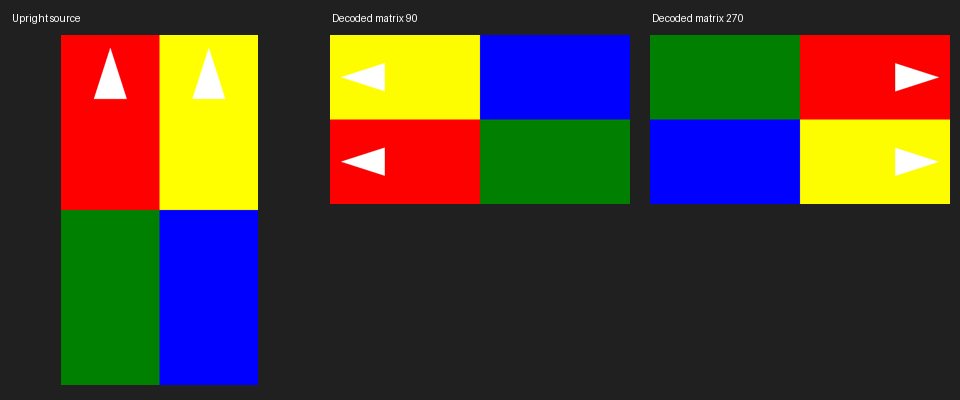
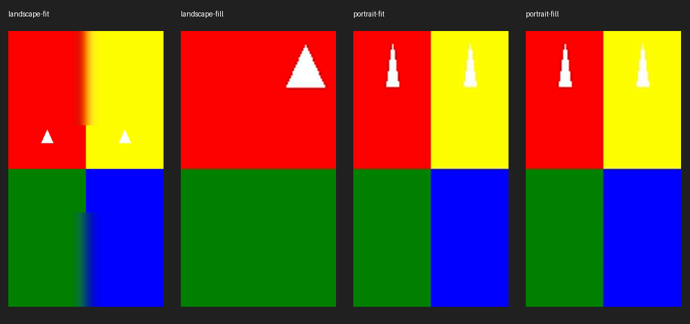

# Shorts geometry and Director preview contracts

2026-10-20 · SHORTS-006/007 · `fix/shorts-geometry-validation`

The branch carries forward the preceding uncommitted playback/performance work.
This selected D073 boundary adds only renderer-contract hardening and its tests.
There were no paid calls, production renders, parent-file edits, automatic media
regeneration or merges.

## Decisions

**Reject unsupported rotation explicitly (strategy B).** The inherited FFprobe
parser previously discarded display matrices. A small default-no-op probe hook
now lets the Shorts adapters inspect the original stream report. The Shorts hook
rejects rotation tags and any display matrix, including a zero-angle matrix that
could contain mirroring/scaling. Malformed rotation metadata gets an actionable
validation error. No rotation evidence is silently stripped or normalized.
The message requests a separately normalized upright, square-pixel MP4 copy and
explicit verification/selection; the application does not create that copy.

Non-square or malformed source pixel aspect ratios are also rejected because
the crop contract uses square-pixel geometry. Ordinary landscape/portrait sources
with square pixels retain the existing Fit/Fill filters and focal coordinates.
Fit's wide foreground over a blurred portrait canvas remains intentional.

The normal render probe and still-preview path both enforce the geometry gate
before crop/filter execution. Still preview uses a metadata-only FFprobe query;
it does not count every source frame merely to inspect a display matrix.

**Keep selected-scene Director previews.** The adapter now requires one scene,
rebased to frame 0, positive frame span and positive FPS, with the graph's required
scene fields. Unsupported whole-board calls fail before any media process or
graph construction. The application already supplies exactly this local board.
Final `render()` continues supplying all scene inputs and rendering the full board.
Preview sampling stays inside the selected scene, including scenes under 0.5 s.

Both final renderers now require explicit proof of 1080×1920, SAR 1:1, DAR 9:16,
progressive scan and no rotation/display matrix, in addition to their existing
frame count, duration, packet, H.264/AAC and full-decode checks. Raw SAR/DAR evidence
is retained in reports; missing output proof is rejected. Codec settings, source
intervals and candidate/revision publication gates are unchanged. Historical
artifacts are retained; existing outputs are not automatically regenerated.

Product changes are limited to `providers/ffmpeg_delivery.py` (default probe hook),
`providers/ffmpeg_shorts.py` (Shorts geometry validation and preview preflight),
and `providers/ffmpeg_director.py` (output validation and explicit preview input).
The shared delivery/finishing behavior is unchanged by the default hook.

## Before/after reproduction

`reports/shorts_geometry_evidence.py` creates disposable 1080×1920 H.264/AAC marker
media, remuxes separate 90°/270° display-matrix versions, and exercises the adapter.
The before run uses isolated audit commit `70a104b`; the after run uses this branch.
Original fixture checksums remain unchanged in both runs.

| Case | Before | After |
|---|---|---|
| 90° matrix | Coded 1080×1920; decoded 1920×1080; Fill fails inside FFmpeg with invalid crop height 1920 | Explicit `ValueError` naming rotation 90 and requesting an upright verified copy; only FFprobe executes |
| 270° matrix | Same geometry mismatch and crop failure | Explicit rotation/display-matrix rejection (FFprobe represents it as −90°); only FFprobe executes |
| Director one-scene preview | Correct 1080×1920 PNG | Correct 1080×1920 PNG |
| Director two-scene adapter preview | FFmpeg exits with “Invalid file index 1” | Explicit one-scene contract error; no media subprocess executes |
| Director full-board final render | Existing supported path | Remains supported; decoded first/second scene markers and exact timing pass |

Raw commands, probe evidence and errors: [before](shorts-geometry-evidence/before.json),
[after](shorts-geometry-evidence/after.json).

The decoded arrows demonstrate the actual raster rotation, independently of
the coded dimensions:



These are independently decoded final MP4 frames from the new real-media tests.
Landscape Fill shows the selected left focal crop; Fit retains the whole wide
foreground. All arrows remain upright:



## Validation

The new `backend/tests/integration/test_shorts_geometry.py` initially passed all
24 cases in 22.83 seconds. Four real Fit/Fill encodes additionally exported decoded
frames for the visual check above. All fixtures are local/disposable, with 1 FPS
used for bounded 30-second final encodes; existing 25/30 FPS media regressions
exercise the normal production frame rates.

Coverage includes:

- Real landscape and portrait inputs through both Fit and Fill; independent native
  FFprobe and decoded color/arrow markers, frame counts, duration and full decode.
- Left/right focal crop changes across a shot boundary, a nonzero source trim and
  agreement between preview pixels and a decoded rendered frame.
- Real 90°/270° display matrices, actual swapped decoded rasters, actionable
  rejection and proof that no crop/encode process starts.
- Missing rotation tags on ordinary sources; malformed rotation tags/matrix
  structures injected into real FFprobe reports; unsupported source SAR.
- Negative output-proof tests for bad/missing SAR/DAR, unknown scan order and
  unexpected matrix evidence, rather than checking only width and height.
- A real one-scene preview and two-scene final Director encode with distinct
  decoded scene colors; unsupported multi-scene/local-board calls reject early.
- Existing application candidate/revision and source identity tests remain in
  the broader regression run; this patch does not change those gates.

The broader focused regression run passed **121 tests in 252.14 seconds**,
including existing Shorts/Director application and real media tests, delivery
export tests and video-finishing regressions.

Final combined backend command:

```powershell
.venv/Scripts/python.exe -m pytest backend/tests --tb=short
```

Result: **2,674 passed, 12 skipped, 1 failed in 1,675.16 seconds (27m55s)**.
All **184 Shorts/Director cases passed**. The sole failure is the previously
recorded `test_d078_cloud_measurements_drive_duration_repair_without_images`:
`cloud_audio.py:406` raises `Section synthesis incomplete; valid chunks remain
available for retry.` Neither that source file nor its test changed. The audit
and preceding playback verification reproduced the same failure; no additional
failures were introduced. See [test summary](shorts-geometry-evidence/test-summary.json).

`git diff --check` is clean. Changes remain uncommitted and unmerged.
