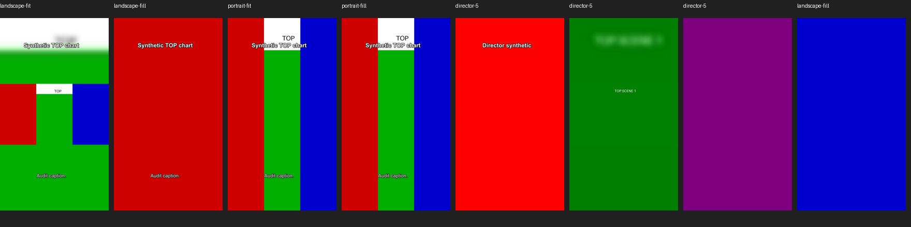

# Shorts orientation, playback and errors audit — October 2026

Audit date: **2026-10-20 (Europe/Warsaw)**. Audit only; no production code fixes.

## A. Executive summary

**Overall verdict: UI PREVIEW CONFUSION.** There are also verified playback/error-recovery defects and two renderer-adapter edge cases. **No landscape-encoded finished Short was reproduced.** This verdict applies to this checkout and the synthetic cases below; it does not certify unidentified user MP4s.

High-confidence conclusions:

1. Original Excerpt review deliberately plays the parent documentary. A landscape documentary therefore looks landscape in the video widget. Fit deliberately preserves that horizontal composition inside a vertical blurred canvas. Neither behavior establishes a landscape encode.
2. There is a concrete source/label mismatch: after a Short is ready, its card's **Play** action loads the parent film into the video widget **while Step 3, “Verified MP4”, and Save MP4 remain active** (SHORTS-001). The file exported is nevertheless the verified Short, not the currently playing parent film.
3. Both real renderers produced verified **1080×1920, SAR 1:1, DAR 9:16, progressive H.264/yuv420p with AAC 48 kHz** outputs. Decoded pixels, Qt video frames and independent FFplay decoding agree. Portrait canvas and a horizontal foreground must be classified separately.
4. Director's “Render / preview” action can leave the original film loaded while status reports READY. Its finishing controls also permit saving/playing the previous output after unsaved finishing changes. Both are separate from Original Excerpt rendering.
5. Playback errors do not reach the panels' status labels. Source preparation, copying, hashing, history/package verification and export still execute synchronously on the GUI thread in Shorts paths. These explain apparent hangs and failures without an actionable message.
6. The suspected Director multi-input preview defect reproduces **at the adapter boundary** for 2 and 5 scenes. It is **not reproduced through the application preview path**: `preview_scene()` deliberately supplies a one-scene local board. Final multi-scene rendering supplies every image input and succeeds.
7. Rotation-bearing inputs expose a real crop-coordinate mismatch: coded dimensions are used before FFmpeg autorotation. A rotated portrait source fails Fill preview and rendering. Fit succeeds and clears rotation in its output. Eligibility of such an input as this application's verified parent documentary is not established.
8. Native Qt playback reproduced an additional timing defect: an immediate seek after `setSource()` is ignored while loading. Playing the second candidate through its card began at the parent's **0 seconds**, rather than its selected **30 seconds**. Retrying source playback after loading sought correctly (SHORTS-008). Original review can therefore show/hear the wrong passage, independently of output correctness.

**Eight confirmed findings**, including the two explicitly bounded adapter findings; no P0. Do not interpret all eight as independently reproduced failures in an existing user project.

### Baseline and boundaries

| Check | Actual local evidence |
|---|---|
| Branch | `perf/indexed-artifact-reads` |
| HEAD | `b9051bbc69bc7b8e911fe4d6b2b51999869aa887` — `short fix`, 2026-10-20 09:42:25 +0200 |
| Initial working tree | Clean (`git status --short` produced no entries) |
| Recent commits | `691f711 shorts fix`; `a792c6a perf: index artifact reads and scope Timeline history (D081)` |
| Three-step UI | Implemented in `desktop/shorts_panel.py:81–162`; technical controls/Director under Advanced |
| D071 repairs | Detached analysis reader, `asyncio.to_thread` discovery, phase messages, retained analysis/selection receipts and first-current restoration present (`application/shorts.py:101–255`, `shorts_panel.py:514–546`) |
| Overlap recovery | `domain/shorts.py:select_excerpts`, `excerpt_capacity`; verified-pool fallback and provenance present; strict unknown-reference rejection retained |
| Indexed access | `storage/local_store.py:221–258` uses ID/key lookup and index-backed catalog when composed with an index; standalone stores have their own catalog |
| Async media work | `application/video_render.py:26,35–64` uses `current_async`/`stage_async`; this does not make separate Shorts staging asynchronous |
| Python | Repository `.venv/Scripts/python.exe`: CPython **3.11.9**, 64-bit Windows |
| Qt | PySide6 **6.11.2**, Qt **6.11.2** |
| Media tools | PATH FFmpeg/FFprobe/FFplay **8.1.2-full_build-www.gyan.dev**, gcc 16.1.0 build; source composition uses PATH, installed builds prefer bundled tools (`desktop/deployment.py:media_executables`) |

No GitHub/master equivalence is assumed. No fetch, merge, PR, paid call, model load/download or production render was performed. No existing user project/database/media/cache was opened, copied, overwritten or regenerated. All fixture stores and child SQLite projects were temporary. The audit read local code, architecture, ADR 0003 and the D071–D073/D081 target/evidence documentation. The implementation-only “one D### task” rule does not select a fix in this audit.

## B. Orientation and artifact/path matrix

`store._artifact_path(...)` below always resolves a configured store key. “Observed” separates real media measurements from fixture-backed UI routing assertions.

| Action | Actual source/type | Expected orientation | Observed orientation / widget and source | Result / label / saved artifact |
|---|---|---|---|---|
| A. Select suggested Short | Current candidate + retained edit; verified original/branded/delivery source MP4 | Parent orientation during review; final orientation if a current render exists | `load()` clears player, restores draft; `check_output()` loads rendered MP4 if current; otherwise `cue_source()` cues parent at excerpt start, no autoplay. Same `QVideoWidget` | “2. Review and Create”; no crop applied to parent playback. A current ready selection instead enters Step 3 |
| B. Preview original excerpt with audio | Full parent source MP4, seek + pause-at-end range | Parent orientation (tested landscape 1920×1080) | `play_source → cue_source → setSource(parent URL)`; shared `QVideoWidget`; original bytes and original audio | “Preview excerpt with audio”; card label only “Play”. No vertical processing. Not an export selection |
| C. Vertical crop/captions/hook preview | Temporary staged parent → FFmpeg-generated `preview.png` | 1080×1920 | `vertical_preview → service.prepare/preview → renderer.preview`; separate `QLabel`, scaled within 270×480 | “Preview vertical crop / captions / hook”; actual filtered still, no audio/motion playback. Captions require enabled burn-in; external SRT alone is not visible |
| D. Create Original Excerpt | Exact approved interval from staged `source.mp4` → new `short.mp4`, type `shorts_video` | 1080×1920 | Fit/Fill + overlays + audio trim → encode → probe/packet/full decode → complete selection | “Create Short”; “Short ready. Preview, then Save MP4.” Only verified output selected |
| E. Play verified finished Short | `current_output(candidate)` → selected `shorts_video` | 1080×1920 | `play_short()` sets rendered URL and removes excerpt stop bound; same video widget moved to Step 3 | “Play current Short”; correct. Exception: card Play can subsequently replace the displayed source, SHORTS-001 |
| F. Save MP4 | `output()` → `current_output()` → selected `shorts_video`, irrespective of player URL | Byte-identical to rendered Short | Atomic `QSaveFile` copy; digest/size and selection revalidated after dialog | “Save MP4”; real synthetic export reopened as 1080×1920. Parent URL is not used for copying |
| G. Create AI Director version | Accepted candidate lineage; owned derived child project; retained script/audio/board/images | No output yet; source playback retains parent orientation | Explicit factory creates Director scope. Merely entering mode/creating scope does not generate paid assets. Director has its own player/widget | “Create AI-directed version”; no MP4 produced by this action |
| H1. Director original story preview | Parent original/branded/delivery MP4; candidate start/end | Parent orientation | `DirectorPanel.play_source()` switches to **4 Finish** and loads parent URL into Director `QVideoWidget` | “Preview original story with audio”; Finish location can be misleading |
| H2. Director image/vertical preview | Selected verified still/generated image → selected-scene `image-0.png` → `preview.png` | Raw image orientation for original-image action; 1080×1920 for vertical preview | Separate image `QLabel`; local single-scene board retains mode/focal/motion and measured captions; hook only on first scene | “Preview actual vertical scene / new captions”; no whole-storyboard movie preview |
| H3. Director render/play/save | Ordered stills + derived measured PCM + captions/finish/logo → `director.mp4`, type `shorts_director_video` | 1080×1920 | All 1/2/5-scene real renders passed. Render action updates status but not player URL. Explicit `play_output()` loads `current_output()` | “Render / preview current directed Short” can leave parent displayed; “Play verified directed Short” corrects it. Save uses Director output selection, not parent |

### Widget proportions and Fit semantics

`ShortsPanel.video` has min 140×180 and max 200×240, not a 9:16 viewport (`shorts_panel.py:140–148`). Both widgets' actual `aspectRatioMode()` values were queried as **KeepAspectRatio** (`widget-settings.json`). Qt's aspect-preserving widget displays horizontal media with bars; a true vertical image also cannot fill a 200×240 viewport. There is no explicit media-kind/orientation label immediately attached to the shared widget. The full-size filtered still is separate and hidden under Advanced. The Director widget minimum is 240×360, likewise not a strict 9:16 constraint.

Fit graph: split input, scale/crop background to 1080×1920, blur background, scale foreground to fit the canvas, center overlay, `setsar=1`, `format=yuv420p`. For the tested square-pixel 1920×1080 input, the foreground is approximately 1080×608, surrounded by blurred image. This is an intentional **portrait encode containing a horizontal picture**, not a landscape video or black-letterboxed encode.

Fill graph: derive even crop coordinates with `crop_box`, select x by relative per-shot times, crop, scale to 1080×1920, `setsar=1`, `format=yuv420p`. Tested left/right focal points selected red/blue regions at 1/16 seconds respectively; no accidental scene timing drift was observed. Source extraction seeks to absolute start; shot coordinates are relative to the excerpt. The still preview shifts PTS by relative preview time to use the same crop expressions.

## C. Reproduced findings

### SHORTS-001 — Ready card Play replaces finished media with the parent film (P1)

- **Location:** `backend/app/desktop/shorts_panel.py:313–319,356–404,647–659` (`select_card`, `update_workflow`, `cue_source`, `play_short`).
- **Reproduction:** Create a verified fixture Short; activate the panel (rendered URL loaded). Click that same ready candidate's card **Play**. Also occurs when clicking Play on another already-rendered candidate after its load completes.
- **Expected:** In Step 3, the displayed source matches the verified Short information, or original playback is explicitly labeled and shown in the review context.
- **Actual:** Parent URL and excerpt stop bound replace the rendered URL. `verified_output` remains current; Step 3 and Save MP4 remain enabled and say “Verified MP4”.
- **Evidence:** Temporary audit test `test_ready_card_play_displays_parent_in_finish_step` asserts parent URL, visible Step 3, enabled export, correct output identity, and recovery through `play_short`. Export test proves saved bytes are still Short bytes.
- **Confidence:** High, deterministic UI routing reproduction; dummy UI media bytes are not used as proof of encoding. Independent real playback proves the parent's landscape orientation.
- **Minimal recommendation:** Track displayed media kind and reconcile the card action with the workflow context; label original review explicitly. Preserve access to original audio review and the correct export selection.

### SHORTS-002 — Qt playback errors never become panel errors (P2)

- **Location:** `desktop/shorts_panel.py:145–149,457–463,653–659`; `desktop/director_panel.py:79–81,188–195,242–244`.
- **Reproduction:** Emit `QMediaPlayer.errorOccurred(ResourceError, ...)` / `FormatError` on each panel's player after a ready status. Both labels remain ready. Real missing/corrupt sources separately fail FFprobe with “No such file or directory” / “moov atom not found”.
- **Expected:** Playback failure appears persistently with the attempted media kind and a usable recovery action.
- **Actual:** Neither panel connects `errorOccurred`; synchronous `run()` wrappers cannot catch an asynchronous decoder failure. No visible status change or diagnostic category.
- **Evidence:** `test_media_errors_are_not_shown`; source signal wiring inspection. Actual hardware/codec failure with a valid finished MP4 was not reproduced.
- **Confidence:** High for missing signal handling, bounded for hardware-specific behavior.
- **Minimal recommendation:** Connect player errors/status to persistent, source-aware UI diagnostics; keep a verified render retained when only playback fails.

### SHORTS-003 — Shorts preparation/verification/export still block the GUI (P1)

- **Location:** `application/shorts.py:335–350,355–382,393–428`; `shorts_panel.py:328–340,387–413,483–501,547–601,638–648,667–677,687–688`; `storage/shorts.py:32–72`; `desktop/artifact_export.py:33–47`. Director: `shorts_director.py:322–346,373–385` and `director_panel.py:255`.
- **Reproduction:** Instrument `stage()` with a bounded 200 ms delay and assert its thread ID. Start vertical preview using the actual panel timer/async loop. No Qt heartbeat fires during that delay; staging runs on the GUI owner thread. Real `stage()` copies the **entire parent MP4**, then hashes that entire copy, for every preview/render.
- **Expected:** Slow immutable-media work leaves progress, repaint and Cancel responsive; SQLite remains on its owner thread.
- **Actual:** The coroutine is pumped by `tick()` on the GUI thread. Work before an actual asynchronous subprocess wait blocks Qt. Source checks also rehash parent bytes through `publishing.original()`, and ready/card checks repeatedly verify MP4/package bytes and ZIP CRCs. Renderer identity repeatedly hashes the executables. Save MP4 copies/hashes synchronously.
- **Evidence:** `test_staging_runs_on_gui_thread_and_blocks_heartbeat`; direct call chain inspection. This is a threading proof, **not a measured production-project latency benchmark**. Indexed lookup reduces discovery cost but not these byte reads.
- **State/retry:** Frozen UI prevents timely cancel delivery; incomplete work directories remain local. No evidence that a blocked GUI alone corrupts a selected output.
- **Confidence:** High for thread placement and repeated I/O; impact scales with source/history size.
- **Minimal recommendation:** Extend detached-reader/async staging to Shorts with owner-captured identities and conditional publication; stream package validation/export off-thread. Preserve SQLite ownership and byte-integrity checks.

### SHORTS-004 — Director render READY leaves the parent player source loaded (P2)

- **Location:** `desktop/director_panel.py:193–195,239–244,255`.
- **Reproduction:** Prepare a deterministic offline Director project; Preview original story; Render / preview current directed Short.
- **Expected:** The render/preview control loads the verified directed output or clearly requests the separate playback action.
- **Actual:** `render()` saves finishing settings, awaits rendering and refreshes status only. The parent URL and excerpt stop bound remain loaded in the Finish widget while status says render READY. `start()` stops playback, so this is retained source/frame context, not proof of automatic parent replay.
- **Evidence:** `test_director_render_keeps_source_loaded_and_finish_edits_not_guarded` asserts unchanged player URL and READY status. Real renderer measurements independently prove the produced file is vertical.
- **Confidence:** High.
- **Minimal recommendation:** Load verified output and clear source bounds after successful render, and show media-kind labels in Finish.

### SHORTS-005 — Unsaved Director finishing changes do not guard Play/Save (P2)

- **Location:** `desktop/director_panel.py:70–78,95–98,236–255`; `application/shorts_director.py:308–316,389–391`.
- **Reproduction:** Render a current Director Short. Change the finishing headline (same problem for burn-in/font/duration/branding), then Play or Save without “Save finishing settings” or Render.
- **Expected:** Changed finishing controls visibly invalidate readiness or require explicit save/discard before using the previous output.
- **Actual:** Finishing widgets have no draft-tracking signal connections. `unsaved` covers script/scene only; `current_output()` uses persisted finish settings. The old output remains valid to service queries and is what Save selects, despite the visibly edited finish controls.
- **Evidence:** The Director UI audit test asserts `not unsaved`, unchanged output identity, and unchanged persisted headline after editing the visible headline.
- **Confidence:** High. The retained old artifact is valid; the defect is the missing UI draft boundary, not loss of history.
- **Minimal recommendation:** Track finish drafts, invalidate/label current readiness relative to those drafts and require save/discard before playback/export.

### SHORTS-006 — Multi-scene Director adapter preview has missing FFmpeg inputs (P2, latent)

- **Location:** `providers/ffmpeg_director.py:15–43,80–85`; application mitigation at `application/shorts_director.py:373–386`.
- **Reproduction:** Make 2- and 5-scene synthetic boards with all `image-N.png` present; call `FFmpegDirectorRenderer.preview()` directly with the whole board.
- **Expected:** Every graph input is supplied, or a clear validation error restricts preview to a single scene.
- **Actual:** The graph references `[1:v]` and later inputs, but command supplies only `image-0.png`. FFmpeg reports **“Invalid file index 1 in filtergraph description”**, process status `4294967274` on this Windows build. One-scene preview succeeds.
- **Evidence:** `measurements.json`, `director-2.direct_preview_error`, `director-5.direct_preview_error`; synthetic final rendering of the same boards passes with correct scene colors/counts.
- **Reachability:** **Not a confirmed GUI multi-scene failure.** `preview_scene()` selects the scene's actual image, rebases its frames, stages only `image-0.png` and passes a one-scene board. An additional application-level test selected the last scene of a multi-scene fixture, supplied a distinct blue test image through the image boundary and used real FFmpeg: its selected ID, single-scene rebased board, portrait pixels and blue image all matched. Existing real-media integration also exercises that path. Do not “fix” the GUI by sending a whole board to the current adapter.
- **Confidence:** High at the adapter boundary; no evidence of current whole-board callers.
- **Minimal recommendation:** Make the one-scene preview contract explicit and validate it, or add all inputs if full-board preview is intentionally supported. No provider regeneration is needed.

### SHORTS-007 — Fill uses coded geometry before source autorotation (P2, input edge case)

- **Location:** `providers/ffmpeg_delivery.py:45–81` (`probe`); `providers/ffmpeg_shorts.py:17–32,57–62,94–102`.
- **Reproduction:** Generate 1080×1920 H.264/AAC; remux with input option `-display_rotation 90` and stream copy. FFprobe reports coded 1080×1920 plus a 90° Display Matrix; default decode is 1920×1080. Pass the adapter's own probe evidence into Fill preview/render.
- **Expected:** Normalize geometry to the autorotated raster, or reject unsupported rotation before building crop expressions.
- **Actual:** Probe drops display-matrix information and returns 1080×1920. Fill requests `crop=1080:1920` on the autorotated 1920×1080 raster; FFmpeg fails with **“Invalid too big or non positive size … height '1920'”**. Fit succeeds and produces square-pixel 1080×1920 with no remaining matrix. A rotated landscape input also gets crop calculations from the wrong coordinate space, though its crop can remain legal.
- **Evidence:** `playback.json`, `portrait-rotation`; `extra.json`, `portrait-rotation-matrix-render-fill`. The first legacy `-metadata rotate=90` attempt on FFmpeg 8.1.2 created **no matrix** and is explicitly excluded from rotation evidence.
- **Confidence:** High for the adapter/input case. Whether an existing verified parent can carry such a matrix is unverified; ordinary generated square-pixel sources tested here do not.
- **Minimal recommendation:** Retain/reject or normalize rotation and display geometry before cropping; add adapter regression coverage. Do not change normal Fit/Fill editorial behavior speculatively.

### SHORTS-008 — Source seek issued during loading is ignored (P1)

- **Location:** `desktop/shorts_panel.py:313–319,547–601,647–654`; `desktop/director_panel.py:193–195`.
- **Reproduction:** Load a safe 90-second synthetic parent through a temporary Shorts service fixture. Immediately click Play on the second candidate (verified range 30–60 seconds). The panel clears/sets the parent source, calls `setPosition(30000)` before it is loaded and starts playback. Capture real `QVideoSink` frame timestamps and player positions. A separate direct Qt reproduction uses the same source/load/seek/play ordering.
- **Expected:** Playback starts at the selected candidate's 30-second boundary and stops at its 60-second boundary.
- **Actual:** The first frame is timestamp 0; subsequent frames/player position advance from the beginning. Calling `play_source()` again after loading successfully seeks to at least 30 seconds. The parent end bound remains 60 seconds, so the initial playback can include unwanted earlier content. Director always sets the source and immediately seeks, using the same problematic ordering; an end-to-end Director candidate timing test was not separately run.
- **Evidence:** `test_card_source_seek_before_loaded_starts_at_zero` passed with the actual panel and real MP4; `panel-immediate-seek.json` records initial/retry timestamps. `immediate-seek.json` independently records an ignored 15-second seek on a newly loaded 30-second file. This is independent of the widget's aspect ratio and does not affect FFmpeg extraction boundaries.
- **Confidence:** High on this Windows Qt 6.11.2 backend for card playback and the underlying load ordering. Backend-dependent behavior should be tested rather than assumed across platforms. Clicking the normal excerpt button after an already-loaded candidate can work correctly.
- **Minimal recommendation:** Defer a source-specific pending seek/play until loaded/seekable; bind it to a candidate/source token so a delayed callback cannot seek a newer candidate. Test real frame timestamps and actual excerpt stopping, not just `setPosition()` call arguments.

## D. FFmpeg measurements and visual evidence

All principal fixture outputs use **30.000000 s, 5 fps, 150 decoded video frames**, to bound CPU work while still satisfying the production renderer's 30–60 s duration contract. Existing focused integration tests separately exercise ordinary 25/30 fps. Audio is AAC-LC mono 48 kHz; principal outputs measured 30 s video/audio. Every successful production-renderer return included packet timestamp verification, full decode, checksum and byte size.

| Output | Width×height / coded dimensions | SAR / DAR | Rotation side data | Decoded raster | Content inspection |
|---|---|---|---|---|---|
| Landscape → Original Fit | 1080×1920 / 1088×1920 | 1:1 / 9:16 | None | 1080×1920 | Entire red/green/blue horizontal chart on blurred background; hook/caption visible |
| Landscape → Original Fill | 1080×1920 / 1088×1920 | 1:1 / 9:16 | None | 1080×1920 | Red left focal at 1 s, blue right focal at 16 s, caption/hook correct |
| Portrait → Original Fit | 1080×1920 / 1088×1920 | 1:1 / 9:16 | None | 1080×1920 | Upright portrait chart, white TOP marker |
| Portrait → Original Fill | 1080×1920 / 1088×1920 | 1:1 / 9:16 | None | 1080×1920 | Upright full portrait chart, white TOP marker |
| Director 1 scene | 1080×1920 / 1088×1920 | 1:1 / 9:16 | None | 1080×1920 | Red scene, correctly oriented overlay |
| Director 2 scenes | 1080×1920 / 1088×1920 | 1:1 / 9:16 | None | 1080×1920 | Red then green, Fit/Fill and subtle motion applied |
| Director 5 scenes | 1080×1920 / 1088×1920 | 1:1 / 9:16 | None | 1080×1920 | Red/green/blue/orange/purple in expected order; representative first/second/fifth frames inspected |
| Saved/reopened Original Fit | 1080×1920 | 1:1 / 9:16 | None | Same encoded bytes | Production export helper; checksum equal to input Short |
| Rotated-source Fit (both input shapes) | 1080×1920 | 1:1 / 9:16 | None in output | Machine full decode passed | Does not retain source's 90° display matrix |
| Rotated portrait → Fill | No valid output | N/A | 90° matrix in source | Source decodes 1920×1080 | Preview and render reject invalid crop at FFmpeg, SHORTS-007 |

Principal outputs: H.264 **High profile, level 40, avc1, yuv420p, progressive**. Coded width 1088 is codec alignment; visible width 1080 is correct and not an orientation defect. FFprobe did not report `rotate` tags, display-matrix/rotation side data or `display_rotation` fields for normal finished outputs. The explicit rotated sources contain the matrix rows `0 -65536 0 / 65536 0 0 / 0 0 1073741824`, rotation 90. Source coded/display dimensions differ after autorotation as documented above.

The shared probe records SAR but normal verification does not enforce SAR == 1:1 or explicitly validate DAR/matrices. Normal filters do set square pixels; this is a validation-hardening opportunity, not proof of a wrongly oriented published file. Non-square-pixel anamorphic inputs were not tested.

Qt `QVideoSink` captured 1920×1080 for the original and 1080×1920 for Fit, Fill and five-scene Director, with no Qt errors. Eight further real Qt lifecycle checks loaded the original, final, another source and reopened export, stopping/replaying each successfully with the expected frame raster and no errors (`lifecycle.json`). FFplay independently decoded each principal playback file for one second with SDL dummy video/audio drivers, exit 0 and matching stream geometry. This proves decoder agreement, not visible native-window sizing or human listening. Representative decoded FFmpeg frames were visually inspected, rather than relying solely on metadata.

## E. Error inventory and recovery

Original Excerpt uses `run → error()` or `tick → task.result → error()`; nonempty exception text remains in the outer status label with `status_error=True`. Candidate navigation and dirty signals normally preserve it; the next explicit action clears the flag and may replace the message. Step readiness is calculated separately, so ERROR can coexist with retained valid output controls. Director uses plain `status.setText(str(exc))` in `run`/`tick`; no persistent error flag, and `refresh()` can replace it with stage summaries. Raw FFmpeg errors can be long, unclassified and include staged paths/filter graphs. Neither panel maintains a user-facing diagnostic history.

In the table, **R** means retry after resolving the trigger; **paid** describes a fresh explicit retry, not an automatic call. No paid providers were invoked during this audit.

| Stage / trigger | Exact code boundary / exception | Visible message and persistence | Retained state, retry, paid exposure and actionability |
|---|---|---|---|
| Missing/non-Standard source; bad binding | `ShortsService.source:30–37`, `PublishingPackageService.original/source` → `ValueError` | “Shorts requires a completed Standard project.” / “Current Standard plan/script binding is required.” / MISSING/STALE/BLOCKED text | Prior history retained; R after completing/selecting current source; no paid call. Source discovery catches several errors and may present only “No verified source”, concealing the specific reason until explicit validation |
| Missing/stale candidate | `candidate:264–270` → `ValueError` | “Unknown Short candidate.” / “STALE: candidate source changed; analyze the current source.” | No downstream write; stale cards disabled where recognized; R via analysis/review. New analysis may be paid |
| No viable intervals / count impossible | `analyze:158–240`, `select_excerpts` → `ShortAnalysisError('insufficient_candidates',…)` | Phase-prefixed “Shorts analysis failed during Finding excerpts…”; lower Candidates / review Timeline | Existing candidates retained; no provider call before feasibility checks; actionable |
| Invalid/unknown AI assessment; transport failure | `analyze:198–246` → `ShortAnalysisError` / provider exception wrapped by panel `analyze:545–546` | “failed during AI analysis: … Previous candidates retained.” | No fabricated success or automatic analysis retry. Retained matching responses/analysis can be reused; failed/uncached transport retry may be paid |
| Project/source changes during analysis | `ShortsService._validate_analysis…`, `analyze` → `ValueError` | “Project changed during analysis…” / “Source changed during analysis…” with phase context | No stale selection published; R after refresh; a provider response may already have incurred cost |
| Original playback decoder/file failure | `play_source/cue_source`, asynchronous `QMediaPlayer` | Synchronous prepare errors appear; Qt asynchronous errors **not surfaced**, SHORTS-002 | No media mutation; R after source/device fix; no paid call; poor diagnosability |
| Original playback begins at wrong boundary | `cue_source/play_source`, `DirectorPanel.play_source` → **no exception** | No error/status change when loading discards the immediate seek, SHORTS-008 | Parent and output histories unchanged; retry after load can work. Wrong excerpt may be reviewed or accepted; no paid call and no effect on FFmpeg's saved interval |
| Edit conflict / invalid title | `save_edit:289–301` → `ValueError` | “Short edit changed; reload before saving.” / “Invalid Short edit structure/title.” | Existing revisions retained; UI draft remains; R after reload/correction; no paid call |
| Invalid range / branding insertion / duration | `prepare`, `domain.shorts.mapped_interval/speech_interval` → `ValueError` | “Choose ordered verified sentence/scene boundaries…” / “An excerpt cannot cross an inserted branding card.” / “actual frame-aligned Short must be 30-60 seconds.” | Save/render fail before publication; draft retained; correct verified boundaries; no paid call |
| Missing editorial approval | `create_short:435–441`, `render:373` → `ValueError` | “Explicitly accept…” / “Accept the excerpt after editorial/audio review before rendering.” | No render; reviewed acceptance required, no paid call. Approval is candidate-scoped; crop/title edits preserve decision history; range changes clear UI acceptance |
| Caption absence/staleness | `prepare:323–331`, `check_captions:406–424` → `ValueError` | MISSING measured alignment; “Captions do not belong to this exact source and Timeline.” / “No measured captions overlap…” | Caption controls disabled with reason; retained enabled edit can explicitly remove captions; retry with valid alignment or captions off; no automatic alignment API call |
| Unsafe hook/caption/style | `ShortStyle.__post_init__`, `overlays` → `ValueError` | “Invalid safe Short presentation settings.” / “Overlay exceeds two readable lines; reduce text or font size.” / “Caption is too short for burn-in.” | Draft retained; correct content/style; no paid call; specific wrapping message is actionable |
| Bad crop points / foreign shots | `ShortStyle`, `prepare:321` → `ValueError` | “Crop focal points must reference a shot and be between 0 and 1.” / “Crop references a shot outside the excerpt.” | No new edit/output; R after correction; no paid call |
| Staging failure / disk full / changed bytes | `stage:335–342` → `OSError` / `ValueError` | OS text / “Source changed while staging.”; no stage classification | Existing selection safe; partial temp work may remain. R after storage/source fix; rendering itself has no paid calls. GUI may freeze before message |
| Missing encoder / FFprobe launch | `preview:345`, `identity:356`, `MediaProcess.run` → `ValueError` / OS launch error | “Configure trusted local FFmpeg/FFprobe…” or raw OS text | No selected partial output; R after configuration fix; no paid call |
| Preview time invalid / FFmpeg filter failure | `preview:344–353`, renderer preview / `MediaProcess.run` → `ValueError` / `RuntimeError` | “Preview time outside excerpt.” / “Media process exited …”; raw filter diagnostics | Old selection retained; old preview may remain after a failed retry if settings were unchanged. Correct range/filter/input; no paid call |
| Corrupt/missing media | `FFmpegDeliveryExporter.probe`, real FFprobe → `RuntimeError` | “moov atom not found … Invalid data found…” / “No such file or directory” | Rejected before output verification; raw message lacks app category. R with valid source; no paid call |
| Encoding/deadline/cancel | `MediaProcess.run:watch_cancel/finally` → `RuntimeError`, `TimeoutError`, `RenderCanceled` | “Media process exited …” / “Media process exceeded its execution deadline.” / “Render canceled during process execution.” | Process tree cleaned up; incomplete work file can remain unselected. Real cancellation after encoding began reproduced. Prior output safe; R is local work only |
| Malformed FFprobe/render evidence | `probe`, `FFmpegShortsRenderer.render:66–81`, `ShortsService.render:389–403` → `ValueError` / malformed missing keys can yield `KeyError` | “FFprobe delivery stream report is incomplete or invalid.” / “Short frame count, duration, dimensions or A/V synchronization failed.” / “Incomplete or invalid Short evidence; previous valid selection retained.” | Mock malformed width rejected before selection; full decode/packet checks fail closed. Bare key messages less actionable; R after fixing encoder/input; no paid call |
| Concurrent edit/reject/source change during render | `ShortsService.render:386–388` → `ValueError` | “Short edit/source/decision changed while rendering.” | New output not selected; preceding selection/history retained; R current reviewed revision; no paid call |
| Publication/package failure | `render:396–428`, store atomic import → `OSError` / `ValueError` | OS error / “Short bytes changed after decode.” | Selection written last. Earlier video/meta may be retained without a complete selection; no parent replacement. R local render/cache where complete |
| Damaged selected MP4/package on reopen | `ProjectShorts.verify/completed/cached/selected` → `ValueError`, `OSError`, `KeyError`, `BadZipFile` | “Short checksum mismatch.” / “Short package is incomplete or damaged.”; `check_output()` suppresses **ValueError** and merely hides Step 3; cached scans skip damaged entries | History preserved; damaged output not reused. Some OS/ZIP failures propagate. No explanatory persistent error for suppressed ValueError; retry local render, no paid call |
| Save MP4 destination / changed selection / short write | `copy`, `copy_artifact:15–50` → `ValueError` / `OSError` | “Save exported copies outside the immutable artifact directory.” / “Short changed before copy.” / “Source media changed while copying.” / OS text | Dialog cancel is harmless. Atomic save cancels on failure, destination not partially published; retry new location/current output, no paid call. Successful export has no persistent saved-path state |
| Director scope/script/source review | `ShortsDirectorService.__init__`, `generate_script`, `validate_script`, `approved_script` | “Accept the source story…” / “Configure a structured LLM…” / “REVIEW REQUIRED: approve the current script…” / strict reference/numeric/part errors | Parent untouched; manual revisions/proposals retained. Script/hook generation explicit; uncached retry may be paid, with configured provider transport behavior |
| Director narration / voice / measured duration | `generate_narration`, `audio_bytes`, `narration:162–172` | “Missing owned derived narration.” / “Narration identity or PCM measurements changed.” / “NARRATION STALE…” / measured out-of-range status | Child owns narration and recovery; no parent fallback. Listen/approve gate; R correct voice/script/duration. Audio retries depend on retained chunks/selections; may incur paid synthesis for missing work |
| Director storyboard/asset failure | `storyboard`, `validate_board`, `image` | “BLOCKED: generate/review the new storyboard.” / exact timing/reference/hold errors / “BLOCKED: approve and generate the missing image for …” | No output selected; scene edits preserved; reused imagery verified. R may require explicit paid storyboard/image work |
| Director image approval/provider/cancel | `missing_images`, `approve_images`, `generate_missing_images:293–306` | “Explicit approval of the current image count/provider/model is required.” / “Invalid provider image bytes/dimensions.” / cancel text | Earlier published images reused. Current paid response canceled before publication can require repeating that image. No automatic re-approval or blanket regeneration |
| Director render/verification/currentness | `prepare_render`, `render:337–371`, `current_output` | “Configure a D068 channel logo, or disable branding.” / “Invalid/partial directed render evidence.” / “Director inputs changed during rendering…” / “STALE/BLOCKED: render the current directed Short.” | Verify bytes and complete MP4/SRT/meta selection last; prior variants retained; R local render. `cached()` skips invalid variants and can collapse corruption into generic stale/blocked |
| Director edits/play/save/reopen | `require_saved`, `create`, `play_output`, `copy`, `refresh` | “Save or explicitly discard director script/scene edits first.”; service errors shown in single status label | Script/scene guards work; finish draft guard missing (SHORTS-005); stage refresh can replace earlier errors. Child reopening uses normal scope ownership; existing production DBs were not inspected |

### Swallowed and misleading statuses

- `ShortsPanel.check_output()` suppresses every `ValueError` from current-output resolution, including integrity errors; missing output and damaged output become visually similar.
- `load()` suppresses a `ValueError` from `cue_source()` for unfinished drafts. This keeps edits accessible but can leave playback unavailable without a specific new explanation.
- `ProjectShorts.cached()` / Director cache skip damaged selections intentionally. This protects correctness, but a subsequent generic MISSING/STALE label loses the original corruption cause.
- `publishing.sources()` catches `ValueError/OSError/KeyError` for each source; the initial no-source view can hide configuration or lineage details.
- `DirectorPanel.create()` ignores a `ValueError` while restoring storyboard. That can represent no storyboard or stale/invalid storyboard; it is not an assertion that recovery succeeded.
- No audited path simply suppresses a renderer failure and publishes an invalid output as success. UI status and actual selection validation must still be considered separately.

## F. State transitions and stale-media analysis

| Transition | Implemented behavior | Audit assessment |
|---|---|---|
| No source/candidate → analysis | Eligible source and exact count/target validated; analysis state blocks duplicate dispatch | Repaired D071 behavior present; no implicit paid retry |
| Candidate → original excerpt | Load clears previous source; cues parent and sets end bound | Expected original orientation; limited media-kind labeling. Immediate card Play can ignore the pre-load seek and start at zero, SHORTS-008 |
| Original excerpt → vertical still | Separate filtered QLabel; player stopped by `start()` | Does not convert the player's source to vertical video |
| Review → accepted → rendering | Explicit checkbox, prepare/save, durable decision, local render; controls disabled | No implicit acceptance just from selecting/playing a card |
| Render → verified ready | Exact evidence/bytes/package selected; `check_output()` loads Short URL, clears excerpt bound, moves widget | Correct initial switch; no background callback found that subsequently reloads parent on its own |
| Ready → card Play | Parent URL loaded without clearing ready state or moving review context | SHORTS-001; deterministic cause of seeing landscape in Step 3 |
| Ready → Play current Short | Revalidates `current_output`, loads rendered URL, clears bound | Correct recovery; replay does not export parent |
| Ready → Stop | Player stops; URL and selection retained | No state conversion to original; real decode/replay is covered separately from mock UI assertions |
| Candidate switch | Stops and clears old source, restores candidate-specific saved edit/draft, selects current output or cues parent | No old candidate output accidentally exported was reproduced. Switching to an unrendered candidate intentionally shows parent again |
| Crop/caption/hook/title/range change | `changed()` marks dirty, clears still/player URL/verified output, hides Step 3; saved revision changes identity | Existing artifact/approval history retained. Range change clears UI review; crop/style change does not automatically delete candidate-scoped acceptance |
| Save new edit | New immutable revision (or identical revision reused); current fingerprint required | Old output remains retained but is unavailable as current output for a changed revision |
| Source change | Candidate/prepare/output compare source ID/checksum/Timeline and block stale use; export revalidates after dialog | Correct guard; no documentary substituted for Short on export |
| Enter/leave Director | Stops both players; separate service/state; no automatic generation | Mode change alone is safe; Director finishing drafts not tracked |
| Director render ready | Status refreshes, source URL unchanged | SHORTS-004 |
| Director finish edit → Play/Save | Uses saved finishing identity | SHORTS-005; previous valid Short can be saved unexpectedly |
| Error/cancel | Original errors flagged; busy reset after cleanup; prior selections retained | Recovery generally possible; decoder errors absent, and sync work delays cancel |
| Save/export → reopen | Copy is atomic and byte-identical; no durable “saved/exported” panel state | No evidence of wrong output bytes. Reopening selection verifies identity/integrity; saved copy reopened with FFprobe successfully |

Moving the widget between Step 2 and Step 3 does **not itself** load a source. Source loading occurs in `load/check_output/cue_source/play_short`. This separation permits SHORTS-001. No autonomous async callback reversion after render was found; user card playback is sufficient to explain it.

## G. Director-specific conclusions

Final graph inputs match ordered images; audio input index is scene count; optional logo index is scene count + 1. Each scene's fill/fit feeds either a static trim or one restrained `zoompan` pass; labels are namespaced and concatenated. Real 2-/5-scene outputs have the correct 150-frame aggregate coverage and visible order. The tests also include Fit, Fill, gentle zoom/pan and overlays. No final missing-stream-input defect was reproduced.

The selected-scene preview deliberately stages the selected image as `image-0.png`, rebases its frame start to zero and retains its duration. It previews at 0.5 seconds, not an arbitrary whole-film position. It shifts the selected measured caption into local time and includes the headline only on the first scene; it does not include the optional final logo. Logo absence in this preview is a fidelity limit, not proof that final logo rendering fails. Exact pixel equality between preview and final at every scene boundary is not established: sentence sample times are rounded to video frames, and preview captions are rebased locally.

Missing image validation happens through `image()` before publication and through graph image opening; a direct preview with missing `image-0.png` reproduced `FileNotFoundError` before FFmpeg launch. Service paths require valid owned/reused/generated images. No paid images, narration or editorial outputs were recreated. Successful machine checks do not replace human narration, factual or standalone-story review.

## H. Recommended implementation order — at most three PRs

1. **Shorts displayed-media identity and playback diagnostics.** Fix SHORTS-001/002/004/008: explicit original-vs-rendered context, correct ready/play transitions, source-token-bound seek after media readiness, strict portrait viewport behavior where appropriate, persistent player errors. Keep original review available and preserve current export validation. Include Director finish draft invalidation (SHORTS-005) in this same UI state boundary. No frontend rewrite.
2. **Responsive Shorts preparation and recovery diagnostics.** Fix SHORTS-003 using owner-captured immutable snapshots, asynchronous byte verification/staging/export and conditional publication. Avoid repeated whole-package reads for every card/status refresh while retaining integrity guarantees. Distinguish missing/stale/corrupt/configuration/process errors and preserve actionable diagnostics. Do not introduce cross-thread SQLite use.
3. **Bounded renderer contracts and display-geometry validation.** Address SHORTS-006/007: explicit single-scene preview contract (or intentional full-board inputs), rotation/display-raster normalization or early rejection, SAR/DAR/matrix validation before publication. Keep normal encoding defaults and Fit/Fill visual direction unchanged unless a test establishes a defect.

There is no confirmed parent-documentary export or landscape-encoded output to prioritize ahead of these. If the user's actual exported MP4 later disproves that, inspect that specific file read-only and revise priority based on evidence.

## I. Deterministic acceptance and executed coverage

Required acceptance tests for implementation PRs:

1. Real 1920×1080 and 1080×1920 synthetic parent sources, Fit and Fill; enforce 1080×1920, SAR 1:1, DAR 9:16, no unexpected matrix/rotation, expected decoded upright marker, frame count/duration/packet/full-decode checks.
2. Per-scene left/right chart changes and a nonzero source trim; compare filtered preview and decoded rendered frame at matching relative timestamps on both sides of a shot boundary. Include caption burn-in, external-only captions and headline independently.
3. Ready candidate card Play, plain selection, original preview, final playback, Stop/replay and candidate switching: assert player URL/media-kind label/widget context at every step, never infer source from enabled Save button. Use actual QVideoSink timestamps for a nonzero candidate start immediately after source replacement, including a second candidate selected before a prior load callback arrives.
4. Save dialog while player is showing original: exported bytes must equal selected Short, never parent. Reopen/decode the copy; changed selection/source during dialog and checksum failure must leave destination unpublished.
5. Dirty crop/caption/hook/range/source must block current export until a corresponding valid render; previous revisions/outputs/decisions remain accessible. Reopening must restore only matching current selections.
6. Director 1-/2-/5-scene boards: exact scene image order, duration/frame coverage, Fit/Fill/motion, selected-scene preview for a non-first scene, hook only where expected, final logo behavior. Direct unsupported multi-scene preview must fail clearly before FFmpeg or supply all streams.
7. Director render after parent playback must load the verified result; every finish widget must mark a draft and guard Play/Save/close until save/discard.
8. Inject QMediaPlayer ResourceError/FormatError; status must identify media kind and remain visible through refresh/navigation until acknowledged/retried. Retained valid output must survive a playback-only failure.
9. Missing/corrupt source, malformed probe/render report, bad overlay/crop, disk/write failure, source mutation and cancellation after encode begins: no invalid complete selection, no parent mutation; retry local work safely.
10. Slow stage/hash/export heartbeat tests must run on detached media work without blocking Qt; cancellation must remain deliverable and SQLite calls stay on the session owner thread. No network, model download or paid provider use.

Executed during this audit:

| Requested synthetic scenario | Evidence / scope |
|---|---|
| Landscape + portrait sources; Fit + Fill | Four real 30-second adapter outputs, measured and visually inspected |
| Multi-scene focal points; captions/hook | Two shot regions; actual caption/hook graph; decoded early/late frames |
| Director one / multiple scenes | Real 1/2/5-scene final renders; direct preview success/failure; existing selected-scene integration test |
| Stop/replay, candidate switches, original → final | Existing panel routing tests plus audit ready-card regression; eight real Qt lifecycle load/replay checks passed for parent/final/other-source/reopened-export files. Human audible playback not asserted |
| Export/reopen | Mock-backed UI export identity test plus real MP4 copied through production `copy_artifact`, checksum equal and reopened with FFprobe |
| Corrupt/missing source | Real FFprobe failures recorded |
| Malformed FFmpeg result | Existing `test_invalid_render_report_not_selected` changes reported width and proves no video/selection publication; malformed JSON/report code inspected |
| Mid-render cancel | Real encode started, cancellation fired after 300 ms; `RenderCanceled`; process cleanup completed, partial work file not a selected artifact |
| Retained old Short after edit | Existing `test_failure_and_cancel_keep_valid_selection_and_source`, fingerprint/reopen/draft tests; Director finish draft discrepancy reproduced |

Final validation results are recorded below. All focused Shorts checks passed; the full backend suite has one pre-existing D078 cloud-duration failure outside this audit's production-code scope.

## J. Uncertainties and evidence limits

- The user did not identify an actual failing Short/project/file. No existing production database, lock, documentary or Short was accessed. The audit cannot attribute a particular historical error or certify a previously exported MP4.
- No true landscape finished encode, wrong-parent export, spontaneous async parent reload after successful render, or final multi-scene missing-image input bug was reproduced in the normal application path.
- Rotation edge reproduction is real at the adapter boundary; a rotation-bearing parent satisfying all upstream application lineage gates was not constructed. Anamorphic/non-square-pixel sources, HDR, VFR and unusual source rotation combinations remain untested.
- Main new synthetic renders use 5 fps to limit CPU usage; existing real-media integration checks provide separate 25/30 fps evidence. No full production documentary render was run.
- Qt offscreen sinks and FFplay dummy drivers prove decoding/geometry agreement, not native visible-window letterboxing, monitor scaling, audio-device behavior, human listening or editorial acceptance. No unavailable VLC comparison is claimed.
- Fake-backed UI tests prove state and selected bytes, not playable media. Real renderer/export/decoder tests establish media facts separately.
- The staging heartbeat test injects a delay to prove thread placement; no timing claim is made for a private production project. Package reads, executable hashing and full source copying are verified from code.
- Director's default selected-scene preview avoids the suspected multi-input bug. Fixing a latent adapter issue should not be represented as repair of a reproduced GUI failure.
- Full-suite failures, if any, must be separated from confirmed Shorts findings. Tests and diagnostics below do not authorize production fixes.

## Reproduction artifacts and validation

Temporary fixture root: `C:/Users/user/AppData/Local/Temp/shorts-audit-2026-10-01z2d0jm`. Fixture MP4/PNG/WAV/project databases remain there, outside production project directories. Reviewable small scripts/JSON and the contact sheet are retained in [shorts-audit-2026-10-evidence](shorts-audit-2026-10-evidence/). The scripts import local test fixtures with fake providers; they do not read `.env` or construct live providers. Their source should be reviewed before rerunning; use a fresh temporary directory rather than reusing their existing `-n` outputs.

- `audit_media.py`: sources, four Original Excerpt renders/previews, Director 1/2/5, failures; `measurements.json`.
- `audit_playback.py`: Qt video sinks, FFplay headless checks, actual rotation matrix inputs, contact sheet; `playback.json`. PowerShell may report NativeCommandError for Qt/FFmpeg stderr despite completed JSON output; decoder results are recorded separately, all four FFplay exits 0.
- `audit_extra.py`: rotation renders, mid-encode cancel, real atomic MP4 export/reopen; `extra.json`.
- `audit_lifecycle.py`: **eight real Qt media load/stop/replay checks passed**, no decoder errors; `lifecycle.json`.
- `test_audit_ui.py`: initial five audit cases **5 passed in 37.81 s**; added selected-nonfirst-scene application preview case **1 passed in 5.81 s**, and actual panel loading/seek regression **1 passed in 3.62 s** in separate focused runs. Seven audit cases passed in total. The source seek case uses the synthetic `landscape/source.mp4` fixture created by `audit_media.py`. First exploratory run had one harness-only Windows slash comparison failure; corrected to compare `Path` objects and reran all five successfully. No product change was made.
- Focused existing Shorts/Director/analysis/selection/media tests: **117 passed in 487.97 s (8:07)**. Command: `.venv/Scripts/python.exe -m pytest backend/tests/unit/test_shorts.py backend/tests/unit/test_shorts_selection.py backend/tests/integration/test_shorts_panel.py backend/tests/integration/test_shorts_director.py backend/tests/integration/test_director_panel.py backend/tests/integration/test_shorts_analysis_snapshot.py backend/tests/integration/test_shorts_media.py backend/tests/integration/test_director_media.py --tb=short`.
- Full `.venv/Scripts/python.exe -m pytest backend/tests --tb=short --junitxml=<temporary-root>/backend-suite.xml`: **2,615 passed, 12 skipped, 1 failed in 1,362.99 s (22:42)**. Failure: `backend/tests/integration/test_duration_repair.py::test_d078_cloud_measurements_drive_duration_repair_without_images`, at test line 432 → `desktop/cloud_audio.py:406`: `ValueError: Section synthesis incomplete; valid chunks remain available for retry.` This exact test/error was already recorded in `docs/desktop/D073_SHORTS_UI.md` before this audit. No production code was changed; it is not counted as a newly confirmed Shorts defect. Summary and traceback: `backend-suite-summary.json`; full raw log/XML remain in the temporary root.
- `git diff --check`: **passed**. The new untracked report was also checked with `git diff --no-index --check -- NUL <report>`; no whitespace errors (only the repository's LF/CRLF informational notice). Evidence JSON parsed and Python harness syntax checked successfully.
- Final production-code/test/docs diff: **empty**. Only this report and the synthetic audit evidence directory were added; no commit, PR or merge.

**Audit stop condition:** no production fixes, branch merge or PR are included. Review this report before selecting implementation work.
